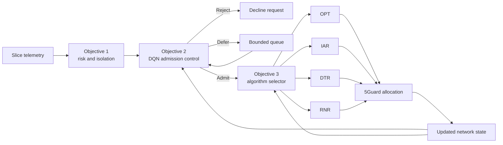

# SecGuard Objectives 2 and 3

This README documents the two decision-intelligence layers added after SecGuard's
threat-to-isolation mapping: learning-based admission control (Objective 2) and
intelligent 5Guard algorithm selection (Objective 3).

## End-to-end workflow



## Status at a glance

| Objective | Model | Main held-out result | Status |
|---|---|---|---|
| Objective 2: admission | NumPy DQN | 64.9% more reward than greedy | Synthetic prototype complete |
| Objective 3: solver selection | Random Forest | 95.35% profit retained, but 80.98% slower than measured FGR | Offline prototype; performance target not met |

## Objective 2: learning-based admission control

Objective 2 observes current capacity, request demands, revenue, duration,
isolation, and risk before choosing `ADMIT`, `REJECT`, or bounded `DEFER`.
Capacity-aware action masking prevents the DQN from overcommitting resources.

### Objective 2 results

| Metric | DQN | Greedy | Value density |
|---|---:|---:|---:|
| Mean total reward | **987.47** | 598.71 | 986.75 |
| Security-adjusted profit | **1020.62** | 626.46 | 1018.05 |
| Admitted requests | 18.92 | 12.92 | **20.26** |
| Infeasible admissions | **0.00** | **0.00** | **0.00** |

DQN beats greedy in all 50 held-out episodes. Its small mean advantage over the
value-density heuristic is not statistically established because the paired 95%
confidence interval crosses zero.


Detailed note: [`objective2.md`](objective2.md)

## Objective 3: intelligent algorithm selection

Objective 3 uses request features and the previous 5Guard state to choose one
solver rather than executing all four ensemble candidates. A low-confidence
prediction falls back to OPT.


### Objective 3 results

| Metric | Result |
|---|---:|
| Held-out decisions | 329 |
| Latency change vs measured FGR | **+80.98% (slower)** |
| Mean profit quality retained | **95.35%** |
| Within-5%-of-best rate | **94.53%** |
| Deadline-feasible selection rate | **95.44%** |
| Mean selector inference | **Sub-millisecond** |

The safe selector did not achieve the originally proposed 90% latency reduction.
It is 80.98% slower than measured FGR and only 1.05% faster than always selecting
OPT on the independent candidate traces because the confidence gate falls back
to OPT on 75.68% of held-out requests. This is an adverse result and shows that
Objective 3 needs further calibration and causal online evaluation.


Detailed note: [`objective3.md`](objective3.md)

## Reproduce both objectives

```powershell
# Objective 2
python -m secguard.admission_control --episodes 2000 `
  --evaluation-episodes 50 --requests 24 --seed 42

# Objective 3
python -m secguard.algorithm_selector

# Verification
python -m pytest tests -q
```

## Generated artifacts

| Artifact | Purpose |
|---|---|
| `artifacts/objective2_admission_control.json` | Objective 2 numerical evidence |
| `artifacts/objective2_dqn.npz` | Trained admission DQN |
| `artifacts/objective2_admission_control.png` | DQN training and baseline figure |
| `artifacts/objective3_algorithm_selector.json` | Objective 3 numerical evidence |
| `artifacts/objective3_selector.joblib` | Trained meta-selector |
| `artifacts/objective3_algorithm_selector.png` | Latency, quality, and confusion figure |
| `artifacts/objective3_architecture.png` | Objective 3 architecture diagram |

## Research boundaries

Both objectives are reproducible synthetic/offline prototypes. Publication-level
claims require direct 5Guard causal replay, BRAIN or additional topologies,
unseen traffic distributions, and online timing under realistic deployment load.
