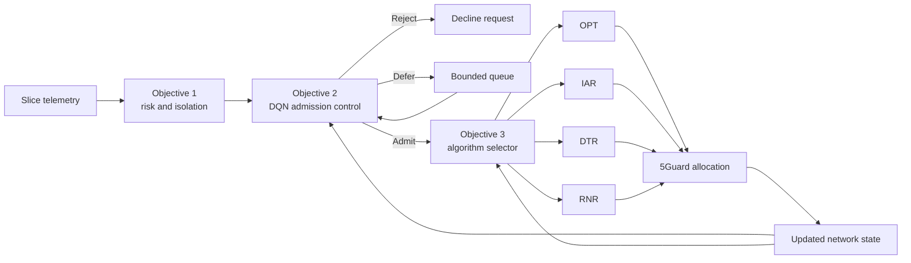

# SecGuard Objectives 2 and 3: Improvements, Results, and Figures

This README documents the two decision-intelligence layers added after SecGuard's
threat-to-isolation mapping: learning-based admission control (Objective 2) and
intelligent 5Guard algorithm selection (Objective 3).

> Numbering note: this project defines Objectives 1, 2, and 3. No Objective 4 is
> currently specified or implemented. The request for results for "2 and 4" is
> interpreted here as Objectives 2 and 3.

## What improved?

| Objective | Comparison | Measured improvement | Evaluation |
|---|---|---|---|
| 2: Admission control | DQN versus greedy | **64.93% higher reward**, **62.92% higher security-adjusted profit**, **46.44% more admissions** | 50 paired held-out synthetic episodes |
| 3: Algorithm selection | One selected solver versus four candidates | **75.00% fewer solver calls**, **23.44% lower estimated solver work** | 329 held-out offline decisions |

These improvements use different baselines and should not be added together.
Objective 2's reward advantage over value density is inconclusive. Objective 3
preserves 94.63% mean profit quality, but its response latency is 62.77% slower
than the stored measured FGR response. The following sections report those
trade-offs alongside the gains.

## End-to-end workflow



## Status at a glance

| Objective | Model | Main held-out result | Status |
|---|---|---|---|
| Objective 2: admission | NumPy DQN | 64.9% more reward than greedy | Synthetic prototype complete |
| Objective 3: solver selection | Random Forest | 75% fewer solver calls and 23.44% less estimated solver work | Offline computational improvement; response target not met |

## Objective 2: learning-based admission control

Objective 2 observes current capacity, request demands, revenue, duration,
isolation, and risk before choosing `ADMIT`, `REJECT`, or bounded `DEFER`.
Capacity-aware action masking prevents the DQN from overcommitting resources.
The implementation adds experience replay, a target network, and bounded
deferral so the agent can account for resources becoming available later.

Training used 2,000 episodes of 24 requests, with seed 42. Evaluation used
50 held-out episode seeds, 10042--10091. All policies receive the same request
trace in each episode, making their differences paired comparisons.

### Objective 2 results

| Metric | DQN | Greedy | Value density |
|---|---:|---:|---:|
| Mean total reward | **987.47** | 598.71 | 986.75 |
| Security-adjusted profit | **1020.62** | 626.46 | 1018.05 |
| Admitted requests | 18.92 | 12.92 | **20.26** |
| Rejected requests | 5.08 | 11.08 | **3.74** |
| Deferral actions per episode | 24.76 | 0.00 | 16.56 |
| Infeasible admissions | **0.00** | **0.00** | **0.00** |

Against greedy, this means **54.15% fewer rejected requests** as well as the
reward, profit, and admission gains above. Deferral actions can exceed the
number of requests because a request may be deferred more than once.

DQN beats greedy in all 50 held-out episodes. The paired mean reward gain is
388.76, with an approximate 95% confidence interval of [356.64, 420.89]. Its
gain over value density is only 0.73 reward units (about 0.07%), with an
interval of [-22.27, 23.73]. The current evidence therefore establishes a gain
over greedy without establishing superiority over value density.

The higher admission rate also has costs: DQN's mean modeled security cost is
37.19 versus greedy's 27.13, and DQN uses more deferral actions. The reward
already accounts for the configured penalties, but it is not a measured
operational currency or a measured attack-containment rate.


*Figure 1. The left panel shows the 25-episode training reward average; the
right panel compares held-out mean reward. The almost equal DQN and
value-density bars make the stronger-baseline result visible.*

Detailed note: [`objective2.md`](objective2.md)

## Objective 3: intelligent algorithm selection

Objective 3 uses request features and the previous 5Guard state to choose one
solver rather than executing all four ensemble candidates. A low-confidence
prediction falls back to OPT.


*Figure 2. The selector predicts a single solver from request information and
previous network state, with an OPT fallback for low-confidence predictions.*

The 400-tree Random Forest uses 22 features available before allocation. It
trains on simulation iterations 0--6 (771 rows) and tests on iterations 7--9
(329 rows). Its label is the fastest deadline-feasible candidate whose observed
profit is within 5% of the best feasible candidate. Complete iterations are
kept together to prevent a random row split from mixing a simulation across
training and evaluation.

### Objective 3 results

| Metric | Result |
|---|---:|
| Held-out decisions | 329 |
| Solver-call reduction vs run-all | **75.00%** |
| Estimated solver-work reduction | **23.44%** |
| Mean profit quality retained | **94.63%** |
| Within-5%-of-best rate | **89.67%** |
| Deadline-feasible selection rate | **95.14%** |
| Response latency vs measured FGR | **+62.77% (slower)** |
| Recorded mean inference timing per held-out row | **1.34 ms** |

The recorded inference timing covers both the balanced and safe prediction
batches divided by the held-out row count; it is not a single online request
latency benchmark.

The balanced selector improves computation by running one solver rather than
four. A safe 60% confidence profile is also retained: it preserves 95.35% profit
quality while reducing estimated solver work by 14.88%. Response latency still
does not meet the proposed target, so causal online evaluation remains required.

| Profile / reference | Solver work per decision (s) | Estimated work saved vs run-all sum | Mean profit quality retained |
|---|---:|---:|---:|
| Balanced selector, confidence 0.45 | 1.2245 | **23.44%** | 94.63% |
| Safe selector, confidence 0.60 | 1.3615 | **14.88%** | **95.35%** |
| Independent run-all sum | 1.5994 | Reference | Not a measured ensemble policy result |

The balanced selector is also 11.01% faster than always choosing OPT on these
independent trajectories (1.3760 s). However, the measured FGR response is
0.7523 s. Aggregate work and response latency are different quantities: the
23.44% work saving is computed from the sum of four independently replayed
candidate runtimes, rather than a causal online run-all experiment. Solver-call
counts are an architectural comparison; both savings still require direct
online validation.


*Figure 3. Held-out solver-selection comparison, including quality and latency.*


*Figure 4. Estimated solver work, solver invocations, and the confidence-gate
trade-off between computation and retained profit quality.*

Detailed note: [`objective3.md`](objective3.md)

## Reproduce both objectives

```powershell
# Objective 2
python -m secguard.admission_control --episodes 2000 `
  --evaluation-episodes 50 --requests 24 --seed 42

# Objective 3
python -m secguard.algorithm_selector

# Verification
python -m pytest tests -q
python -m secguard.objective_status
```

## Generated artifacts

| Artifact | Purpose |
|---|---|
| `artifacts/objective2_admission_control.json` | Objective 2 numerical evidence |
| `artifacts/objective2_dqn.npz` | Trained admission DQN |
| `artifacts/objective2_admission_control.png` | DQN training and baseline figure |
| `artifacts/objective3_algorithm_selector.json` | Objective 3 numerical evidence |
| `artifacts/objective3_selector.joblib` | Trained meta-selector |
| `artifacts/objective3_algorithm_selector.png` | Latency, quality, and confusion figure |
| `artifacts/objective3_computation_tradeoff.png` | Solver-work, invocation, and quality trade-off |
| `artifacts/objective3_architecture.png` | Objective 3 architecture diagram |

## Research boundaries

Both objectives are reproducible synthetic/offline prototypes. Publication-level
claims require direct 5Guard causal replay, BRAIN or additional topologies,
unseen traffic distributions, and online timing under realistic deployment load.

The current project suite contains **40 passing tests**. The source JSON files
listed above are the numerical authority for these figures and tables. No new
training or solver benchmark was run for this documentation update.
