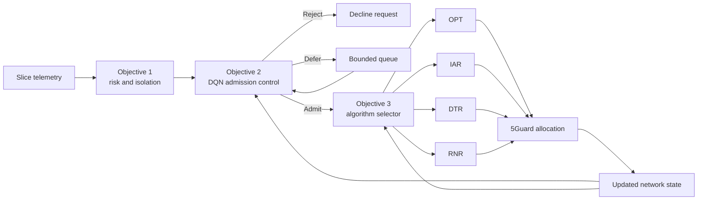
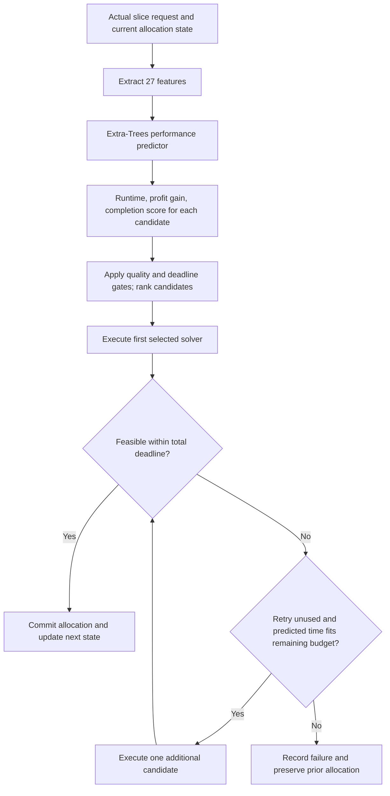
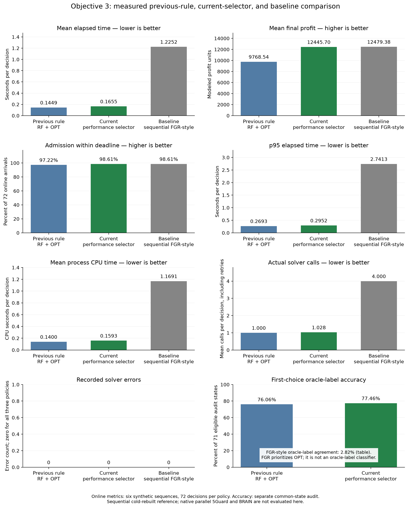

# SecGuard Objectives 2 and 3: Methodology and Experimental Results

This README documents the two decision-intelligence layers added after SecGuard's
threat-to-isolation mapping: learning-based admission control (Objective 2) and
intelligent 5Guard algorithm selection (Objective 3).

## Overview

| Aspect | Objective 2 | Objective 3 |
|---|---|---|
| Decision | Admit, reject, or defer an incoming slice | Select the allocation algorithm for a request |
| Motivation | Admission consumes resources that later requests may need. | Running every candidate algorithm requires extra computation. |
| Method | Deep Q-Network (DQN): reinforcement learning | Extra-Trees performance prediction |
| Input | 14 numerical features about capacity and the request | 27 actual request, topology, and allocation-state features |
| Output | One action: admit, reject, or defer | One algorithm: OPT, IAR, DTR, or RNR |
| Evaluation environment | A synthetic admission simulator | Causal synthetic solver replay |

## Summary of improvements

| Objective | Comparison | Measured improvement | Evaluation |
|---|---|---|---|
| 2: Admission control | DQN versus greedy | **64.93% higher reward**, **62.92% higher security-adjusted profit**, **46.44% more admissions** | 50 paired held-out synthetic episodes |
| 3: Algorithm selection, new replay | Performance selector versus sequential cold-rebuilt FGR-style reference | **86.49% lower measured elapsed time**, **86.37% lower process CPU time**, **99.73% final profit retained** | 72 online decisions per policy across six unseen synthetic sequences |

These improvements use different baselines and should not be added together.
Objective 2's reward advantage over value density is inconclusive. The new
Objective 3 result uses measured elapsed time and a sequential cold-rebuilt
FGR-style reference; it does not establish superiority over a parallel ensemble.

## End-to-end workflow

The diagram shows the intended combined architecture. Objectives 2 and 3 are
currently implemented and evaluated as separate components; these results are
not measurements of a single integrated online deployment.



## Status at a glance

| Objective | Model | Main held-out result | Status |
|---|---|---|---|
| Objective 2: admission | NumPy DQN | 64.9% more reward than greedy | Synthetic prototype complete |
| Objective 3: solver selection | Extra-Trees performance predictor with budget-aware retry | 86.49% lower elapsed time versus sequential cold-rebuilt FGR-style reference, retaining 99.73% final profit | Causal synthetic replay complete; parallel/BRAIN validation remains |

## Objective 2: learning-based admission control

### 1. Problem and approach

Admission decisions affect both immediate revenue and future resource
availability. Accepting a resource-intensive, long-duration slice may prevent
later requests from being served. Bounded deferral allows active slices to
finish and release resources before a pending request is reconsidered.

Objective 2 observes current capacity, request demands, revenue, duration,
isolation, and risk before choosing `ADMIT`, `REJECT`, or bounded `DEFER`.
Capacity-aware action masking prevents the DQN from overcommitting resources.
The implementation adds experience replay, a target network, and bounded
deferral so the agent can account for resources becoming available later.

### 2. Input and output

The DQN receives one normalized vector with **14 features**:

| Feature group | Exact inputs | Count |
|---|---|---:|
| Current network | CPU load, radio load, bandwidth load, active-request fraction, mean remaining lifetime of active requests | 5 |
| Incoming request | CPU demand, radio demand, bandwidth demand, revenue, duration, isolation level, risk score | 7 |
| Decision context | Request deferral fraction, remaining-request fraction | 2 |

The network architecture is deliberately small:

```text
14 input features -> 64 ReLU hidden units -> 3 Q-values
                                            |
                         block invalid actions using the action mask
                                            |
                              choose the highest valid Q-value
                                            |
                                ADMIT / REJECT / DEFER
```

A Q-value estimates an action's future discounted reward; it is not a class
probability. Admission is masked when any resource demand exceeds available
capacity. A deferred request goes to the back of the pending queue, and each
request can be deferred at most twice. The environment advances time after
every decision and releases expired allocations.

The evaluation generator creates synthetic risk scores and isolation levels
that preserve the base isolation floor. It does not stream predictions from
the Objective 1 detector into a live 5Guard admission loop.

### 3. Reward formulation

There are no manually labeled correct admission actions. The simulator gives
the agent a reward after each action:

```text
If admitted:
    reward = revenue - resource charge - isolation charge - security charge
If rejected:
    reward = -0.04 * revenue
If deferred:
    reward = -0.02 * revenue
```

The admission charges use these configured formulas:

```text
demand_fraction = mean(CPU demand / CPU capacity,
                       radio demand / radio capacity,
                       bandwidth demand / bandwidth capacity)
resource charge  = 0.15 * revenue * demand_fraction
isolation charge = 0.08 * revenue * isolation_level / 2
security charge  = 0.25 * revenue * risk * sharing_factor
sharing_factor  = 1.0 for L0, 0.5 for L1, 0.0 for L2
```

These are modeled costs in simulation units. In particular, a zero sharing
factor at L2 is a modeling assumption, not proof that L2 prevents every attack.
Episode reward includes rejection and deferral penalties; security-adjusted
profit is admitted revenue after the three admission charges and excludes
those rejection/deferral penalties. This explains why their totals differ.

### 4. Implementation and training

1. Built an environment with CPU, radio, and bandwidth capacities of 100 units
   each. Requests come from four service profiles: eMBB, uRLLC, mMTC, and MC,
   with randomized demands, revenue, duration, and risk.
2. Implemented the 14--64--3 Q-network using NumPy. Training uses Huber loss,
   learning rate 0.005, and batches of 32 transitions.
3. Stored transitions in a replay buffer of up to 10,000 entries. Sampling past
   transitions allows the agent to reuse experience during training.
4. Updated the learning target using immediate reward plus 0.97 times the
   maximum valid next-action value from a target network. Terminal states have
   no future reward. Copied weights to the target network every 50 updates.
5. Used epsilon-greedy exploration during training, decreasing epsilon from
   1.0 toward 0.05. Evaluation disables random exploration.

We selected DQN because this is a sequential decision problem with a small
discrete action set and numerical state features. The experiment does not
establish that a neural network is necessary or that DQN is better than other
RL algorithms such as PPO; those comparisons have not been run.

### 5. Evaluation design

Training used 2,000 episodes of 24 requests, with seed 42. Evaluation used
50 held-out episode seeds, 10042--10091. All policies receive the same request
trace in each episode, making their differences paired comparisons.

The baselines are explicit:

- **Greedy:** admit whenever capacity permits; otherwise reject. It does not
  defer requests.
- **Value density:** if capacity is insufficient, defer while permitted;
  otherwise use a fixed threshold on risk-adjusted revenue per normalized
  resource demand and duration to decide whether to admit.

Because greedy does not defer while DQN and value density can defer, the
comparison does not isolate the benefit of learned decisions from the benefit
of allowing deferral. A greedy-with-deferral ablation is still needed.

### 6. Results and impact

The main comparison below focuses on DQN versus greedy admission.

| Metric | DQN | Greedy |
|---|---:|---:|
| Mean total reward | **987.47** | 598.71 |
| Security-adjusted profit | **1020.62** | 626.46 |
| Admitted requests | **18.92** | 12.92 |
| Rejected requests | **5.08** | 11.08 |
| Deferral actions per episode | 24.76 | 0.00 |
| Infeasible admissions | **0.00** | **0.00** |

Against greedy, this means **54.15% fewer rejected requests** as well as the
reward, profit, and admission gains above. Deferral actions can exceed the
number of requests because a request may be deferred more than once.

DQN beats greedy in all 50 held-out episodes. The paired mean reward gain is
388.76, with an approximate 95% confidence interval of [356.64, 420.89]. Its
gain over value density is only 0.73 reward units (about 0.07%), with an
interval of [-22.27, 23.73]. The current evidence therefore establishes a gain
over greedy without establishing superiority over value density.

The higher admission rate also has costs: DQN's mean modeled security cost is
37.19 versus greedy's 27.13, and DQN uses more deferral actions. The reward
already accounts for the configured penalties, but it is not a measured
operational currency or a measured attack-containment rate.


*Figure 1. DQN versus greedy admission across 50 paired held-out synthetic
episodes. Bars show means; error bars show approximate 95% confidence intervals
for each policy mean. Improvements are relative to greedy. The complete
baseline comparison is retained in the source JSON.*

Figure 1 shows higher mean reward, security-adjusted profit, and admissions
than greedy. Results use one trained DQN; consistency across independent
training seeds remains to be evaluated.

The practical impact demonstrated here is more profitable use of the modeled
capacity than immediate greedy admission. Zero infeasible admissions comes
from the capacity mask and environment checks; it is not evidence of perfect
learned decision accuracy.

This RL evaluation has no ground-truth action labels,
so classification accuracy is not reported. Winning against greedy in 50/50
episodes is a paired reward result, not 100% accuracy. The agent admits about
78.83% of incoming requests (18.92/24); that is an admission rate, not accuracy.

Detailed note: [`objective2.md`](objective2.md)

## Objective 3: intelligent algorithm selection

### 1. Methodology and implementation

The implementation uses common-state training data, actual resource and
request-complexity features, candidate-specific runtime/profit/success
prediction, validation-only configuration selection, and a budget-aware retry.
Each policy's accepted allocations update its own next state.

| Component | Implementation | Purpose |
|---|---|---|
| Prediction task | Predict runtime, incremental profit, and completion-success score for each algorithm | Compare expected outcomes explicitly |
| Features | 27 actual request, topology-size, and allocation-state features | Represent request difficulty and current resource pressure |
| Candidate training data | Four candidates evaluated on copies of the same pre-decision state | Make candidate comparisons consistent |
| Selection rule | Fastest predicted candidate meeting configured quality, feasibility, and deadline gates | Balance computation against expected allocation quality |
| Failure handling | At most one retry when predicted runtime fits the remaining deadline budget | Recover from a failed first choice while accounting for extra work |
| State transition | Execute the selected solver and commit its accepted allocation | Measure consequences over an evolving sequence |
| Timing | Actual elapsed time and process CPU time, including selection overhead and retries | Measure the policy's execution cost |

The Extra-Trees model has 128 trees. Its inputs include actual CPU, radio,
and bandwidth demands; VNF, VNF-instance, and virtual-link counts; topology
size; active slices; existing placements; demand-based load and remaining
capacity proxies; fragmentation; isolation; deadline; revenue; and previous
profit and runtime. The load proxies exclude some isolation/orchestration
overhead, and exact residual transport bandwidth is not available from X/Y.

At each request, the controller:

1. Extracts the 27 features from the incoming request and its own current state.
2. Predicts runtime, incremental profit, and completion success for all four
   candidate algorithms.
3. Filters candidates using the predicted completion score and request
   deadline, and applies a profit-loss budget relative to predicted **total
   allocation profit**. The selected validation settings were 0.95 for quality
   and 0.50 for the completion-score gate.
4. Ranks qualifying algorithms by predicted runtime and executes the first.
   If none qualifies, it ranks candidates by predicted completion success and
   runtime; these predictions do not guarantee feasibility.
5. If the first solver fails, considers one additional candidate only when
   its predicted runtime, with a margin, fits the remaining time budget.
6. Commits the allocation only when it is feasible and completes within the
   total measured request deadline. Otherwise it preserves the prior state.

The runtime adapter reconstructs all required constraints in isolated temporary
models rather than mixing cached models from different solver histories.
Output checks reject invalid results such as profit exceeding total admitted
revenue. Deadline checks count overruns as failures; upstream model
construction is not preemptible, so the runner is not a hard real-time system.



The controller aims to execute one solver per decision. The measured average
is 1.028 calls because bounded retries are included; the run-all reference
executes four candidates per decision.

### 2. Evaluation design and measured impact

The experiment uses 72 training decision points from seeds 100--105, 12
calibration points from seed 200, and 12 configuration-selection points from
seed 201. The final online evaluation uses six fresh seeds, 400--405, with 12
arrivals each. Models and gates are fixed before those final tests. Completion
scores receive sigmoid calibration only where calibration data contain both
success and failure classes; the small sample does not guarantee reliable
probabilities.

In this run, sigmoid calibration was fitted for IAR only. OPT, DTR, and RNR
had only one outcome class in the calibration group, so their calibration was
unavailable. The backend was SCIP with one solver thread and a two-second
optimization limit per call; total elapsed deadline checks also include model
construction, inference, and retries.

See the [measured replay report](artifacts/objective3_online/README.md) for the
metrics and [three-approach comparison figure](artifacts/objective3_online/approach_comparison.png).
The benchmark times a sequential cold-rebuilt FGR-style reference. All policy
timing includes feature extraction, inference, model rebuilding, allocation,
and any retry.

| Metric | Previous selection rule: RF + OPT | Current approach: performance selector | Baseline: sequential FGR-style |
|---|---:|---:|---:|
| Online decisions evaluated | 72 | 72 | 72 |
| Mean measured elapsed time per decision | 0.1449 s | **0.1655 s** | 1.2252 s |
| p95 measured elapsed time | 0.2693 s | **0.2952 s** | 2.7413 s |
| Mean process CPU time per decision | 0.1400 s | **0.1593 s** | 1.1691 s |
| Mean solver calls, including retries | 1.000 | **1.028** | 4.000 |
| Mean final trajectory profit | 9768.54 | **12445.70** | 12479.38 |
| Admission within total deadline | 97.22% | **98.61%** | 98.61% |
| Solver errors | 0 | **0** | 0 |
| Oracle-label agreement, separate common-state audit | 76.06% (54/71) | **77.46% (55/71)** | 2.82% (2/71) |

The previous selection rule is retrained on the same training data and 27
features used in this benchmark; it is not the unchanged saved classifier from
a different experiment. All online columns use the same six input sequences.
The baseline executes four cold-rebuilt candidates sequentially and applies
the FGR OPT-priority rule; it is not native parallel 5Guard.

Oracle-label agreement is measured separately from online trajectory profit
and timing. Its oracle chooses the fastest feasible algorithm within the
configured profit-loss tolerance. FGR prioritizes OPT rather than optimizing
agreement with that label, so its low label agreement does not imply low
allocation profit. One audit row has no feasible candidate, leaving 71
oracle-eligible rows out of 72; all arrivals remain in the online metrics.

| Current approach compared with | Measured impact |
|---|---|
| Previous RF-plus-OPT selection rule | **27.41% higher final profit**, **+1.39 percentage points** admission within deadline, and **+1.41 percentage points** oracle-label agreement; elapsed time is **14.27% higher** |
| Sequential FGR-style baseline | **86.49% lower elapsed time**, **86.37% lower process CPU time**, **74.31% fewer solver calls**, and **99.73% of final profit retained**, with the same admission-within-deadline rate |

The test contains six unseen seeds (400--405), with 12 arrivals each. Against
always selecting OPT, the new selector reduces mean elapsed time by **57.33%**
while retaining the same 99.73% final-profit ratio. Against the retrained
RF-plus-OPT rule on these new features, it increases mean final profit by
**27.41%** and admission-within-deadline by **1.39 percentage points**, but takes
**14.27% more elapsed time**. Those comparisons use actual policy trajectories.



*Figure 2. Direct comparison of the previous RF-plus-OPT rule, current
performance selector, and sequential FGR-style reference. The panels show mean
and p95 elapsed time, mean final profit, admission within deadline, process CPU
time, actual solver calls, recorded solver errors, and first-choice oracle-label
accuracy. Online metrics use 72 decisions per
policy; accuracy uses a separate audit with 71 oracle-eligible states. FGR's
2.82% oracle-label agreement is recorded in the table rather than plotted as
classifier accuracy. Elapsed time includes selection, rebuilding, allocation,
and retries. The reference is sequential, not a parallel production ensemble.*

The figure shows the measured trade-off: versus RF plus OPT, the current
selector gains 27.41% final profit and 1.41 percentage points of oracle-label
accuracy, but takes 14.27% more elapsed time. Versus the sequential FGR-style
reference, it reduces elapsed time by 86.49% and retains 99.73% of final profit.


*Figure 3. Implemented workflows for the previous RF-plus-OPT rule, the current
performance selector, and the sequential FGR-style reference. Each policy
receives the same requests but maintains its own allocation state. The RF
comparator is retrained on the same 27 features. The current selector predicts
three outcomes per candidate and permits one budget-aware retry.*

The elapsed-time saving versus the sequential reference comes primarily from
executing approximately one candidate instead of four, while the performance
estimates guide which candidate to run. The state features and bounded retry
help preserve trajectory profit. These components were changed together;
separate ablations are still required to attribute a numerical gain to each.

The baselines answer different questions:

| Comparison | What it establishes in this benchmark |
|---|---|
| Sequential cold-rebuilt FGR-style reference | 86.49% less elapsed time and 86.37% less process CPU time while retaining 99.73% of mean final profit |
| Always OPT | 57.33% less elapsed time with 99.73% of mean final profit retained |
| Retrained RF-plus-OPT decision rule | 27.41% higher mean final profit and +1.39 percentage points admission within deadline, at a cost of 14.27% more elapsed time |

The RF-plus-OPT comparator is a classification baseline trained on the same
request features and training data. It chooses the predicted algorithm when
confidence is at least 0.45 and chooses OPT otherwise. This comparison tests
the selection rules under the same replay conditions.

### 3. Accuracy, profit retention, and scope

A separate held-out common-state audit gives **77.46% oracle-label accuracy**
(55/71 eligible decisions) for the performance selector, versus **76.06%**
(54/71) for the retrained RF-plus-OPT baseline. This is one additional exact
match on the same audit and does not establish a consistent accuracy gain. In this separate audit the first ranked solver is feasible
on 77.78% of all 72 rows; the online result above follows each policy's own
state trajectory and includes bounded retries.

Accuracy measures agreement with the fastest qualifying oracle algorithm.
Final-profit retention measures the ratio of average profits at the end of
complete policy trajectories. Admission within deadline counts accepted,
feasible requests among all online arrivals. These percentages have different
denominators and should not be treated as interchangeable measures of success.

The evidence supports a faster selector than the controlled sequential
reference and always-OPT on short synthetic sequences, with a small profit
trade-off. It does not yet establish superiority over native parallel 5Guard,
longer-horizon workloads, or the BRAIN topology.


## Implementation and verification artifacts

| Component | Code / evidence |
|---|---|
| Admission simulator, reward, DQN, baselines, evaluation | [`src/secguard/admission_control.py`](src/secguard/admission_control.py) |
| Current performance predictor, state features, replay, and deadline-aware retry | [`src/secguard/online_selector.py`](src/secguard/online_selector.py) |
| New replay metrics, baselines, and uncertainty intervals | [`artifacts/objective3_online/README.md`](artifacts/objective3_online/README.md) |
| Admission tests | [`tests/test_admission_control.py`](tests/test_admission_control.py) |
| Performance selection, state-feature, and audit tests | [`tests/test_online_selector.py`](tests/test_online_selector.py) |
| Prototype acceptance checks | [`src/secguard/objective_status.py`](src/secguard/objective_status.py) |

## Reproduction

```powershell
# Objective 2
python -m secguard.admission_control --episodes 2000 `
  --evaluation-episodes 50 --requests 24 --seed 42

# Objective 3: reproduce the current causal replay on final test seeds
python -m secguard.online_selector --steps 12 --test-seeds 400 401 402 403 404 405
python -m secguard.online_selector --steps 12 --test-seeds 400 401 402 403 404 405 --audit-only
python scripts/report_objective3_online.py

# Regenerate the focused Objective 2 figure from saved results
python scripts/plot_objective2_focused.py

# Regenerate Objective 3 comparison and workflow figures from saved results
python scripts/plot_objective3_comparison.py

# Verification
python -m pytest tests -q
python -m secguard.objective_status
```

## Generated artifacts

| Artifact | Purpose |
|---|---|
| `artifacts/objective2_admission_control.json` | Objective 2 numerical evidence |
| `artifacts/objective2_dqn.npz` | Trained admission DQN |
| `artifacts/objective2_dqn_vs_greedy.png` | Focused DQN-versus-greedy figure used in this report |
| `artifacts/objective2_admission_control.png` | Original training and complete baseline figure |
| `artifacts/objective3_online/results.json` | Current online trajectories, summaries, comparisons, and common-state audit |
| `artifacts/objective3_online/comparison.png` | Current measured elapsed-time, final-profit, and deadline-success figure |
| `artifacts/objective3_online/approach_comparison.png` | Figure 2: direct three-policy comparison with separate accuracy panel |
| `artifacts/objective3_online/selection_workflow.png` | Figure 3: implemented previous-rule, current-selector, and baseline workflows |
| `artifacts/objective3_online/selector.joblib` | Trained performance predictor and retrained RF comparator |
| `artifacts/objective3_online/paired_intervals.json` | Seed-level paired bootstrap intervals |

## Research boundaries

Both objectives remain research prototypes. Objective 2 uses a synthetic
admission environment; Objective 3 now includes causal synthetic solver replay.
Publication-level generalization claims require BRAIN or additional topologies,
unseen traffic distributions, longer sequences, and timing under realistic
deployment load.

Priorities for stronger evidence are a deferral-matched admission baseline,
multiple independent DQN training seeds, comparisons with alternative RL
methods, and one online 5Guard trajectory in which each component's decisions
actually update the next state. Broader security claims also need measured
containment instead of the current exposure-cost proxy. The synthetic
evaluation supports the reported improvements within this scope.

The current project suite contains **49 passing tests**. The source JSON files
are the numerical authority for these figures and tables. The new causal replay
uses separate training, calibration, tuning, and test seed groups; its full
configuration and decision records are retained in `artifacts/objective3_online/`.
