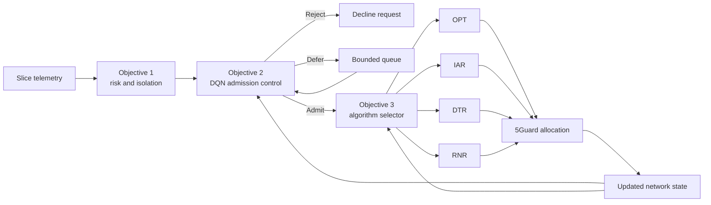
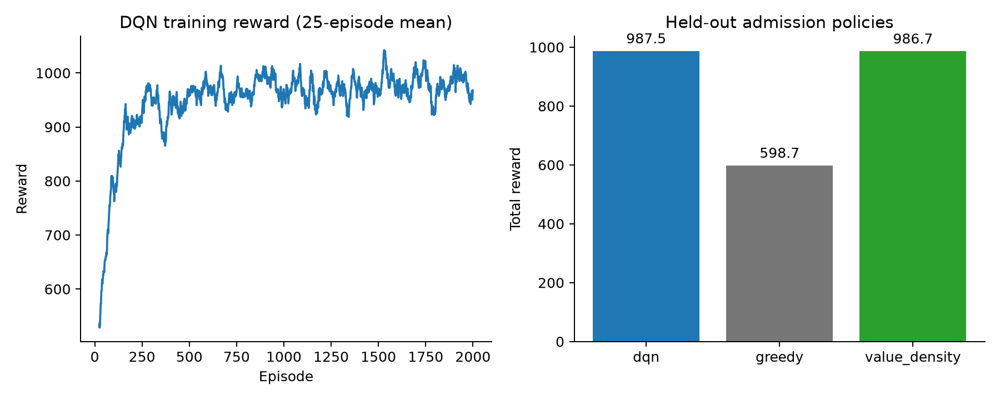
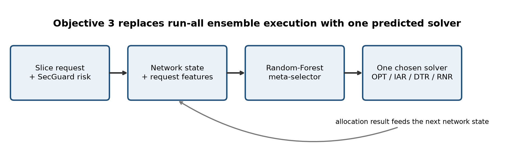
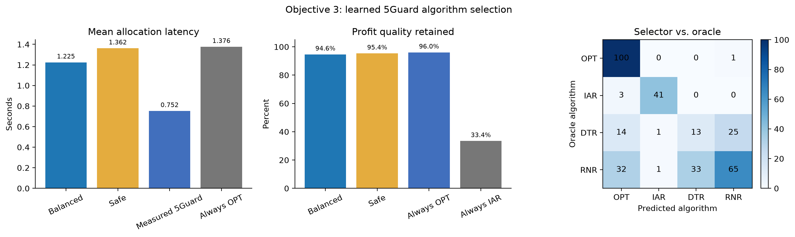
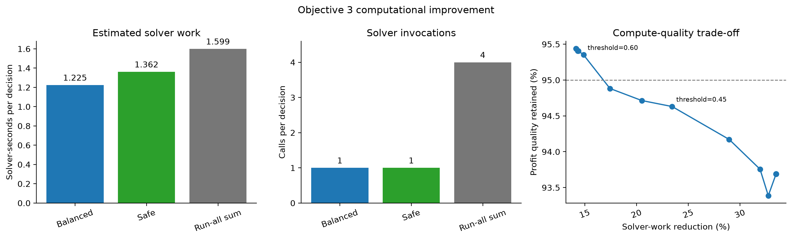

# SecGuard Objectives 2 and 3: Implementation, Impact, and Explanation Guide

This README documents the two decision-intelligence layers added after SecGuard's
threat-to-isolation mapping: learning-based admission control (Objective 2) and
intelligent 5Guard algorithm selection (Objective 3).

## Start here: what are the two objectives?

| Question | Objective 2 | Objective 3 |
|---|---|---|
| What decision do we make? | Should we admit, reject, or defer this slice? | Which allocation algorithm should handle this request? |
| Why is it needed? | An admission consumes resources that later requests may need. | Running every candidate algorithm requires extra computation. |
| Method | Deep Q-Network (DQN): reinforcement learning | Random Forest: supervised classification |
| Input | 14 numerical features about capacity and the request | 22 features about the request and previous simulation state |
| Output | One action: admit, reject, or defer | One algorithm: OPT, IAR, DTR, or RNR |
| What have we evaluated? | A synthetic admission simulator | Offline selection using saved 5Guard solver traces |

### One-minute explanation to present

> **Objective 2:** I implemented an admission controller that considers the
> future consequences of accepting a slice. It observes the resource load and
> request requirements, then uses reinforcement learning to admit, reject, or
> defer the request. I trained a small DQN and compared it with greedy and
> value-density policies on the same held-out request sequences. It improved
> mean reward by 64.93% over greedy, with zero infeasible admissions. Its reward
> was approximately tied with value density, so I do not claim it is the best
> admission method.

> **Objective 3:** I implemented a classifier that predicts which of four
> 5Guard allocation algorithms to choose. I generated training labels from
> saved solver outcomes, choosing the fastest feasible candidate close to the
> best profit. On held-out simulations, choosing one algorithm instead of four
> gave a 75% architectural reduction in solver calls and a 23.44% reduction in
> estimated solver work, while retaining 94.63% mean profit quality. The
> response-latency target was not achieved, and online integration remains to
> be evaluated.

## What improved?

| Objective | Comparison | Measured improvement | Evaluation |
|---|---|---|---|
| 2: Admission control | DQN versus greedy | **64.93% higher reward**, **62.92% higher security-adjusted profit**, **46.44% more admissions** | 50 paired held-out synthetic episodes |
| 3: Algorithm selection | One selected solver versus four candidates | **75.00% fewer solver calls**, **23.44% lower estimated solver work** | 329 held-out offline decisions |

These improvements use different baselines and should not be added together.
Objective 2's reward advantage over value density is inconclusive. Objective 3
preserves 94.63% mean profit quality, but its response latency is 62.77% slower
than the stored measured FGR response. The following sections report those
trade-offs alongside the gains.

## End-to-end workflow

The diagram shows the intended combined architecture. Objectives 2 and 3 are
currently implemented and evaluated as separate components; these results are
not measurements of a single integrated online deployment.



## Status at a glance

| Objective | Model | Main held-out result | Status |
|---|---|---|---|
| Objective 2: admission | NumPy DQN | 64.9% more reward than greedy | Synthetic prototype complete |
| Objective 3: solver selection | Random Forest | 75% fewer solver calls and 23.44% less estimated solver work | Offline computational improvement; response target not met |

## Objective 2: learning-based admission control

### 1. Problem and approach

Suppose resources are nearly full and an incoming slice needs a large amount
of capacity for a long time. Accepting it immediately may prevent later
requests from being served. A short deferral may instead allow active slices
to finish and release resources. This is an illustrative motivation; it is
not a claim that the trained agent always makes the best decision.

Objective 2 observes current capacity, request demands, revenue, duration,
isolation, and risk before choosing `ADMIT`, `REJECT`, or bounded `DEFER`.
Capacity-aware action masking prevents the DQN from overcommitting resources.
The implementation adds experience replay, a target network, and bounded
deferral so the agent can account for resources becoming available later.

### 2. Input and output

The DQN receives one normalized vector with **14 features**:

| Feature group | Exact inputs | Count |
|---|---|---:|
| Current network | CPU load, radio load, bandwidth load, active-request fraction, mean remaining lifetime of active requests | 5 |
| Incoming request | CPU demand, radio demand, bandwidth demand, revenue, duration, isolation level, risk score | 7 |
| Decision context | Request deferral fraction, remaining-request fraction | 2 |

The network architecture is deliberately small:

```text
14 input features -> 64 ReLU hidden units -> 3 Q-values
                                            |
                         block invalid actions using the action mask
                                            |
                              choose the highest valid Q-value
                                            |
                                ADMIT / REJECT / DEFER
```

A Q-value estimates an action's future discounted reward; it is not a class
probability. Admission is masked when any resource demand exceeds available
capacity. A deferred request goes to the back of the pending queue, and each
request can be deferred at most twice. The environment advances time after
every decision and releases expired allocations.

The evaluation generator creates synthetic risk scores and isolation levels
that preserve the base isolation floor. It does not stream predictions from
the Objective 1 detector into a live 5Guard admission loop.

### 3. What the agent learns from

There are no manually labeled correct admission actions. The simulator gives
the agent a reward after each action:

```text
If admitted:
    reward = revenue - resource charge - isolation charge - security charge
If rejected:
    reward = -0.04 * revenue
If deferred:
    reward = -0.02 * revenue
```

The admission charges use these configured formulas:

```text
demand_fraction = mean(CPU demand / CPU capacity,
                       radio demand / radio capacity,
                       bandwidth demand / bandwidth capacity)
resource charge  = 0.15 * revenue * demand_fraction
isolation charge = 0.08 * revenue * isolation_level / 2
security charge  = 0.25 * revenue * risk * sharing_factor
sharing_factor  = 1.0 for L0, 0.5 for L1, 0.0 for L2
```

These are modeled costs in simulation units. In particular, a zero sharing
factor at L2 is a modeling assumption, not proof that L2 prevents every attack.
Episode reward includes rejection and deferral penalties; security-adjusted
profit is admitted revenue after the three admission charges and excludes
those rejection/deferral penalties. This explains why their totals differ.

### 4. How it was implemented and trained

1. Built an environment with CPU, radio, and bandwidth capacities of 100 units
   each. Requests come from four service profiles: eMBB, uRLLC, mMTC, and MC,
   with randomized demands, revenue, duration, and risk.
2. Implemented the 14--64--3 Q-network using NumPy. Training uses Huber loss,
   learning rate 0.005, and batches of 32 transitions.
3. Stored transitions in a replay buffer of up to 10,000 entries. Sampling past
   transitions allows the agent to reuse experience during training.
4. Updated the learning target using immediate reward plus 0.97 times the
   maximum valid next-action value from a target network. Terminal states have
   no future reward. Copied weights to the target network every 50 updates.
5. Used epsilon-greedy exploration during training, decreasing epsilon from
   1.0 toward 0.05. Evaluation disables random exploration.

We selected DQN because this is a sequential decision problem with a small
discrete action set and numerical state features. The experiment does not
establish that a neural network is necessary or that DQN is better than other
RL algorithms such as PPO; those comparisons have not been run.

### 5. How it was evaluated

Training used 2,000 episodes of 24 requests, with seed 42. Evaluation used
50 held-out episode seeds, 10042--10091. All policies receive the same request
trace in each episode, making their differences paired comparisons.

The baselines are explicit:

- **Greedy:** admit whenever capacity permits; otherwise reject. It does not
  defer requests.
- **Value density:** if capacity is insufficient, defer while permitted;
  otherwise use a fixed threshold on risk-adjusted revenue per normalized
  resource demand and duration to decide whether to admit.

Because greedy does not defer while DQN and value density can defer, the
comparison does not isolate the benefit of learned decisions from the benefit
of allowing deferral. A greedy-with-deferral ablation is still needed.

### 6. Results and impact

| Metric | DQN | Greedy | Value density |
|---|---:|---:|---:|
| Mean total reward | **987.47** | 598.71 | 986.75 |
| Security-adjusted profit | **1020.62** | 626.46 | 1018.05 |
| Admitted requests | 18.92 | 12.92 | **20.26** |
| Rejected requests | 5.08 | 11.08 | **3.74** |
| Deferral actions per episode | 24.76 | 0.00 | 16.56 |
| Infeasible admissions | **0.00** | **0.00** | **0.00** |

Against greedy, this means **54.15% fewer rejected requests** as well as the
reward, profit, and admission gains above. Deferral actions can exceed the
number of requests because a request may be deferred more than once.

DQN beats greedy in all 50 held-out episodes. The paired mean reward gain is
388.76, with an approximate 95% confidence interval of [356.64, 420.89]. Its
gain over value density is only 0.73 reward units (about 0.07%), with an
interval of [-22.27, 23.73]. The current evidence therefore establishes a gain
over greedy without establishing superiority over value density.

The higher admission rate also has costs: DQN's mean modeled security cost is
37.19 versus greedy's 27.13, and DQN uses more deferral actions. The reward
already accounts for the configured penalties, but it is not a measured
operational currency or a measured attack-containment rate.



*Figure 1. The left panel shows the 25-episode training reward average; the
right panel compares held-out mean reward. The almost equal DQN and
value-density bars make the stronger-baseline result visible.*

**How to explain this figure:** "Training reward increased as the agent learned.
On unseen episode seeds, the DQN achieved much higher mean reward than greedy,
but value density was nearly equal. The curve is one training run, not evidence
of consistency across multiple independent training seeds."

The practical impact demonstrated here is more profitable use of the modeled
capacity than immediate greedy admission. Zero infeasible admissions comes
from the capacity mask and environment checks; it is not evidence of perfect
learned decision accuracy.

**If asked for accuracy:** this RL evaluation has no ground-truth action labels,
so classification accuracy is not reported. Winning against greedy in 50/50
episodes is a paired reward result, not 100% accuracy. The agent admits about
78.83% of incoming requests (18.92/24); that is an admission rate, not accuracy.

Detailed note: [`objective2.md`](objective2.md)

## Objective 3: intelligent algorithm selection

### 1. Problem and approach

Objective 3 uses request features and the previous 5Guard state to choose one
solver rather than executing all four ensemble candidates. A low-confidence
prediction falls back to OPT.

Objective 2 decides **whether and when** to serve a request. Objective 3 decides
**which allocation algorithm** to use. Objective 3 does not itself compute VNF
placements; the chosen 5Guard algorithm performs the allocation.



*Figure 2. The selector predicts a single solver from request information and
previous network state, with an OPT fallback for low-confidence predictions.*

### 2. Input, output, and label generation

| Feature group | Inputs | Count |
|---|---|---:|
| Simulation progress | Time fraction | 1 |
| Request profile | Isolation, CPU, radio, log-scaled bandwidth, revenue, deadline | 6 |
| Previous FGR state | Profit, migrations, latency, violation cost, overhead, resource efficiency, rejection count | 7 |
| Service identity | One-hot indicators for four service classes | 4 |
| Recent arrivals | Four service-class counts over the preceding ten steps, divided by ten | 4 |

The output is one class from **OPT, IAR, DTR, RNR**. The input uses resource
demands and historical state summaries; the current model does not consume a
full slice graph or raw physical-network graph.

To obtain supervised labels, we read each candidate's saved profit, solver
time, feasibility, and timeout outcome. At each decision point:

1. Keep candidates that are feasible and meet the request deadline.
2. Find the best observed profit among those candidates.
3. Keep candidates within the configured 5% profit-loss tolerance.
4. Label the row with the fastest remaining candidate.

For example, if OPT has the highest profit but RNR delivers almost the same
profit in less time, RNR can become the training label. This example describes
the label rule, not an additional measured result.

Current-step solver outcomes are used to generate labels and evaluate choices;
they are not prediction features. Previous-state features come from the FGR
trajectory, while candidate outcomes come from each algorithm's independent
trajectory. These are therefore offline counterfactual comparisons rather than
four alternatives replayed from one identical evolving allocation state.

### 3. How it was trained and used

The 400-tree Random Forest uses 22 features available before allocation. It
trains on simulation iterations 0--6 (771 rows) and tests on iterations 7--9
(329 rows). Its label is the fastest deadline-feasible candidate whose observed
profit is within 5% of the best feasible candidate. Complete iterations are
kept together to prevent a random row split from mixing a simulation across
training and evaluation.

Rows where none of the four candidates is deadline-feasible are excluded when
building this dataset. The 95.14% success rate therefore applies to the retained
decision points, not to all possible arrivals or all overload conditions.

The Random Forest has maximum tree depth 14 and minimum leaf size 2. At
prediction time, we select the highest-probability class. If that probability
is below 0.45, the balanced profile chooses OPT instead. The safe profile uses
0.60. These are configured confidence thresholds, not guaranteed probabilities
of a correct or feasible allocation. OPT fallback can still miss a deadline.

The 5% tolerance defines the training label, not a guarantee for every model
prediction. On the held-out rows, only 89.67% of selections actually meet that
quality budget. The profile comparisons are descriptive held-out results;
they are not a nested-validation study of threshold selection.

### 4. Results and impact

| Metric | Result |
|---|---:|
| Held-out decisions | 329 |
| Exact match with oracle algorithm label | **66.57%** |
| Solver-call reduction vs run-all | **75.00%** |
| Estimated solver-work reduction | **23.44%** |
| Mean profit quality retained | **94.63%** |
| Within-5%-of-best rate | **89.67%** |
| Deadline-feasible selection rate | **95.14%** |
| Response latency vs measured FGR | **+62.77% (slower)** |
| Recorded mean inference timing per held-out row | **1.34 ms** |

The recorded inference timing covers both the balanced and safe prediction
batches divided by the held-out row count; it is not a single online request
latency benchmark.

**Accuracy versus quality:** 66.57% is the proportion of final selected
algorithms that match the oracle label. A different algorithm can still earn
nearly the same profit, so label accuracy and profit quality need not be equal.
94.63% is a mean bounded quality score, not classification accuracy or a
guarantee of that profit in every case.

The exact implemented score for each feasible decision is:

```text
quality = clip(1 - max(best_profit - selected_profit, 0)
                   / max(abs(best_profit), 1), 0, 1)
```

Infeasible choices receive zero quality. For positive best profit of at least
one unit and selected profit no higher than that reference, this reduces to
selected profit divided by best profit. The normalization also handles small
or negative reference profits.

The balanced selector improves computation by running one solver rather than
four. A safe 60% confidence profile is also retained: it preserves 95.35% profit
quality while reducing estimated solver work by 14.88%. Response latency still
does not meet the proposed target, so causal online evaluation remains required.

| Profile / reference | Solver work per decision (s) | Estimated work saved vs run-all sum | Mean profit quality retained |
|---|---:|---:|---:|
| Balanced selector, confidence 0.45 | 1.2245 | **23.44%** | 94.63% |
| Safe selector, confidence 0.60 | 1.3615 | **14.88%** | **95.35%** |
| Independent run-all sum | 1.5994 | Reference | Not a measured ensemble policy result |

The balanced selector is also 11.01% faster than always choosing OPT on these
independent trajectories (1.3760 s). However, the measured FGR response is
0.7523 s. Aggregate work and response latency are different quantities: the
23.44% work saving is computed from the sum of four independently replayed
candidate runtimes, rather than a causal online run-all experiment. Solver-call
counts are an architectural comparison; both savings still require direct
online validation.



*Figure 3. Held-out solver-selection comparison, including quality and latency.*



*Figure 4. Estimated solver work, solver invocations, and the confidence-gate
trade-off between computation and retained profit quality.*

**How to explain Figures 3 and 4:** "The selector has a lower estimated aggregate
solver workload because it chooses one candidate. However, the selected solver
can be slower than the ensemble's stored response time. The safe profile gives
up some computation saving to preserve more profit quality. These plots show
a compute-quality trade-off, not an achieved 90% response-latency reduction."

The reported solver-time comparisons exclude selector inference, which is
recorded separately. No CPU-utilization, energy-saving, or cloud-cost saving
was measured.

Detailed note: [`objective3.md`](objective3.md)

## How to defend the results in a discussion

| Likely question | Evidence-backed answer |
|---|---|
| Why DQN? | It can estimate long-term values for three discrete actions from numerical network state. It was a practical first RL implementation; we have not compared it with PPO or other RL methods. |
| Is Objective 2 supervised or self-supervised? | Neither: it uses reinforcement learning from simulator rewards. Objective 3 uses supervised labels derived from saved solver outcomes. |
| Did DQN outperform every baseline? | No. It clearly improved over greedy, but its reward was approximately tied with value density. |
| Is zero infeasibility proof of optimal decisions? | No. The capacity mask prevents invalid admissions. It does not prove maximum profit or optimal scheduling. |
| Did Objective 3 reduce response latency by 90%? | No. It reduced architectural solver calls by 75% and estimated work by 23.44%; recorded response latency was 62.77% slower than measured FGR. |
| Is 94.63% the classifier accuracy? | No. It is mean profit quality. Oracle-label accuracy is 66.57%. |
| Are these real network deployments? | No. Objective 2 uses synthetic episodes and Objective 3 uses offline 5Guard synthetic traces. |
| Are the two models already validated together? | No. A causal online experiment integrating admission and selection with the allocator remains to be completed. |

## Where the implementation lives

| Component | Code / evidence |
|---|---|
| Admission simulator, reward, DQN, baselines, evaluation | [`src/secguard/admission_control.py`](src/secguard/admission_control.py) |
| Selector features, label rule, Random Forest, evaluation | [`src/secguard/algorithm_selector.py`](src/secguard/algorithm_selector.py) |
| Admission tests | [`tests/test_admission_control.py`](tests/test_admission_control.py) |
| Selection tests | [`tests/test_algorithm_selector.py`](tests/test_algorithm_selector.py) |
| Prototype acceptance checks | [`src/secguard/objective_status.py`](src/secguard/objective_status.py) |

## Reproduce both objectives

```powershell
# Objective 2
python -m secguard.admission_control --episodes 2000 `
  --evaluation-episodes 50 --requests 24 --seed 42

# Objective 3
python -m secguard.algorithm_selector

# Verification
python -m pytest tests -q
python -m secguard.objective_status
```

## Generated artifacts

| Artifact | Purpose |
|---|---|
| `artifacts/objective2_admission_control.json` | Objective 2 numerical evidence |
| `artifacts/objective2_dqn.npz` | Trained admission DQN |
| `artifacts/objective2_admission_control.png` | DQN training and baseline figure |
| `artifacts/objective3_algorithm_selector.json` | Objective 3 numerical evidence |
| `artifacts/objective3_selector.joblib` | Trained meta-selector |
| `artifacts/objective3_algorithm_selector.png` | Latency, quality, and confusion figure |
| `artifacts/objective3_computation_tradeoff.png` | Solver-work, invocation, and quality trade-off |
| `artifacts/objective3_architecture.png` | Objective 3 architecture diagram |

## Research boundaries

Both objectives are reproducible synthetic/offline prototypes. Publication-level
claims require direct 5Guard causal replay, BRAIN or additional topologies,
unseen traffic distributions, and online timing under realistic deployment load.

Priorities for stronger evidence are a deferral-matched admission baseline,
multiple independent DQN training seeds, comparisons with alternative RL
methods, and one online 5Guard trajectory in which each component's decisions
actually update the next state. Broader security claims also need measured
containment instead of the current exposure-cost proxy. The synthetic
evaluation supports the reported improvements within this scope.

The current project suite contains **40 passing tests**. The source JSON files
listed above are the numerical authority for these figures and tables. No new
training or solver benchmark was run for this documentation update.
