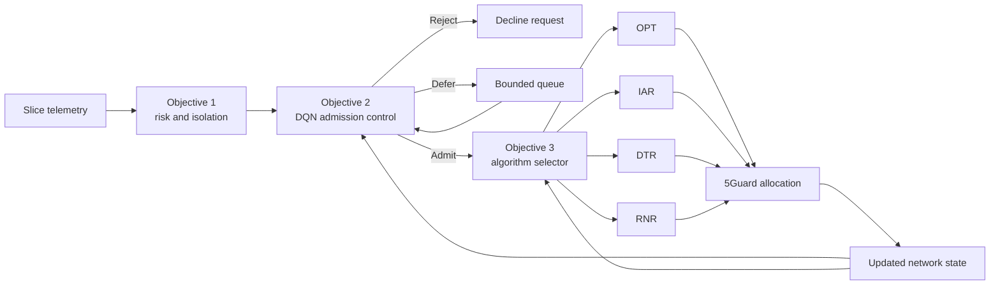
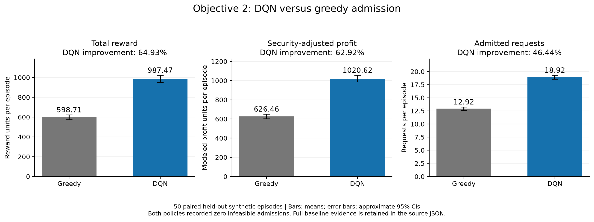
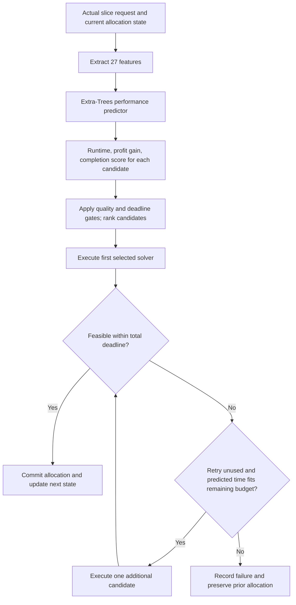
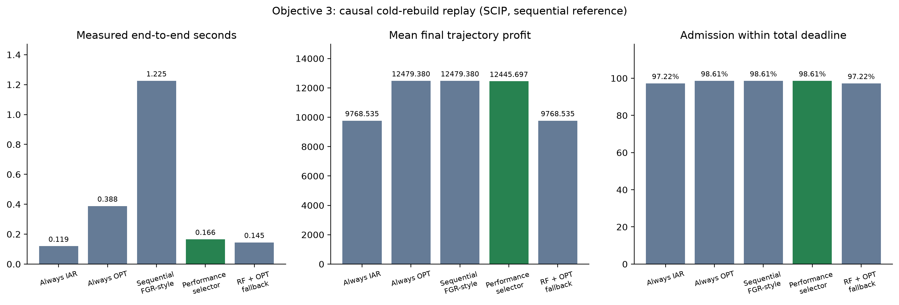
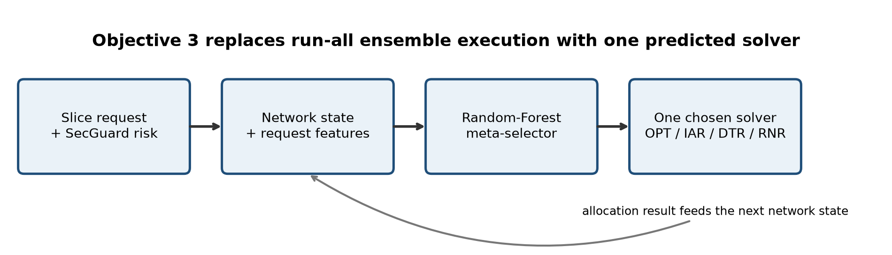
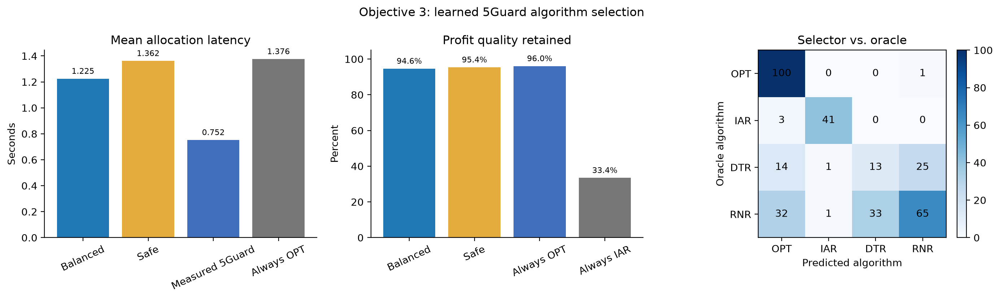
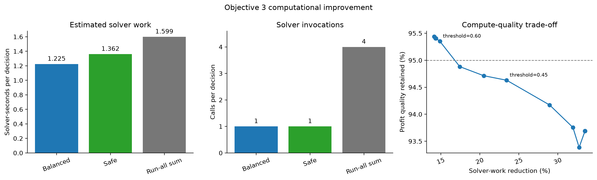

# SecGuard Objectives 2 and 3: Methodology and Experimental Results

This README documents the two decision-intelligence layers added after SecGuard's
threat-to-isolation mapping: learning-based admission control (Objective 2) and
intelligent 5Guard algorithm selection (Objective 3).

## Overview

| Aspect | Objective 2 | Objective 3 |
|---|---|---|
| Decision | Admit, reject, or defer an incoming slice | Select the allocation algorithm for a request |
| Motivation | Admission consumes resources that later requests may need. | Running every candidate algorithm requires extra computation. |
| Method | Deep Q-Network (DQN): reinforcement learning | Extra-Trees performance prediction; earlier version used Random Forest classification |
| Input | 14 numerical features about capacity and the request | 27 actual request, topology, and allocation-state features; earlier version used 22 features |
| Output | One action: admit, reject, or defer | One algorithm: OPT, IAR, DTR, or RNR |
| Evaluation environment | A synthetic admission simulator | Causal synthetic solver replay, with the earlier offline trace experiment retained separately |

## Summary of improvements

| Objective | Comparison | Measured improvement | Evaluation |
|---|---|---|---|
| 2: Admission control | DQN versus greedy | **64.93% higher reward**, **62.92% higher security-adjusted profit**, **46.44% more admissions** | 50 paired held-out synthetic episodes |
| 3: Algorithm selection, new replay | Performance selector versus sequential cold-rebuilt FGR-style reference | **86.49% lower measured elapsed time**, **86.37% lower process CPU time**, **99.73% final profit retained** | 72 online decisions per policy across six unseen synthetic sequences |

These improvements use different baselines and should not be added together.
Objective 2's reward advantage over value density is inconclusive. The new
Objective 3 result uses measured elapsed time and a sequential cold-rebuilt
FGR-style reference; it does not establish superiority over a parallel ensemble.
The earlier offline experiment and its adverse timing result are retained below
with their original scope.

## End-to-end workflow

The diagram shows the intended combined architecture. Objectives 2 and 3 are
currently implemented and evaluated as separate components; these results are
not measurements of a single integrated online deployment.



## Status at a glance

| Objective | Model | Main held-out result | Status |
|---|---|---|---|
| Objective 2: admission | NumPy DQN | 64.9% more reward than greedy | Synthetic prototype complete |
| Objective 3: solver selection | Extra-Trees performance predictor with budget-aware retry | 86.49% lower elapsed time versus sequential cold-rebuilt FGR-style reference, retaining 99.73% final profit | Causal synthetic replay complete; parallel/BRAIN validation remains |

## Objective 2: learning-based admission control

### 1. Problem and approach

Admission decisions affect both immediate revenue and future resource
availability. Accepting a resource-intensive, long-duration slice may prevent
later requests from being served. Bounded deferral allows active slices to
finish and release resources before a pending request is reconsidered.

Objective 2 observes current capacity, request demands, revenue, duration,
isolation, and risk before choosing `ADMIT`, `REJECT`, or bounded `DEFER`.
Capacity-aware action masking prevents the DQN from overcommitting resources.
The implementation adds experience replay, a target network, and bounded
deferral so the agent can account for resources becoming available later.

### 2. Input and output

The DQN receives one normalized vector with **14 features**:

| Feature group | Exact inputs | Count |
|---|---|---:|
| Current network | CPU load, radio load, bandwidth load, active-request fraction, mean remaining lifetime of active requests | 5 |
| Incoming request | CPU demand, radio demand, bandwidth demand, revenue, duration, isolation level, risk score | 7 |
| Decision context | Request deferral fraction, remaining-request fraction | 2 |

The network architecture is deliberately small:

```text
14 input features -> 64 ReLU hidden units -> 3 Q-values
                                            |
                         block invalid actions using the action mask
                                            |
                              choose the highest valid Q-value
                                            |
                                ADMIT / REJECT / DEFER
```

A Q-value estimates an action's future discounted reward; it is not a class
probability. Admission is masked when any resource demand exceeds available
capacity. A deferred request goes to the back of the pending queue, and each
request can be deferred at most twice. The environment advances time after
every decision and releases expired allocations.

The evaluation generator creates synthetic risk scores and isolation levels
that preserve the base isolation floor. It does not stream predictions from
the Objective 1 detector into a live 5Guard admission loop.

### 3. Reward formulation

There are no manually labeled correct admission actions. The simulator gives
the agent a reward after each action:

```text
If admitted:
    reward = revenue - resource charge - isolation charge - security charge
If rejected:
    reward = -0.04 * revenue
If deferred:
    reward = -0.02 * revenue
```

The admission charges use these configured formulas:

```text
demand_fraction = mean(CPU demand / CPU capacity,
                       radio demand / radio capacity,
                       bandwidth demand / bandwidth capacity)
resource charge  = 0.15 * revenue * demand_fraction
isolation charge = 0.08 * revenue * isolation_level / 2
security charge  = 0.25 * revenue * risk * sharing_factor
sharing_factor  = 1.0 for L0, 0.5 for L1, 0.0 for L2
```

These are modeled costs in simulation units. In particular, a zero sharing
factor at L2 is a modeling assumption, not proof that L2 prevents every attack.
Episode reward includes rejection and deferral penalties; security-adjusted
profit is admitted revenue after the three admission charges and excludes
those rejection/deferral penalties. This explains why their totals differ.

### 4. Implementation and training

1. Built an environment with CPU, radio, and bandwidth capacities of 100 units
   each. Requests come from four service profiles: eMBB, uRLLC, mMTC, and MC,
   with randomized demands, revenue, duration, and risk.
2. Implemented the 14--64--3 Q-network using NumPy. Training uses Huber loss,
   learning rate 0.005, and batches of 32 transitions.
3. Stored transitions in a replay buffer of up to 10,000 entries. Sampling past
   transitions allows the agent to reuse experience during training.
4. Updated the learning target using immediate reward plus 0.97 times the
   maximum valid next-action value from a target network. Terminal states have
   no future reward. Copied weights to the target network every 50 updates.
5. Used epsilon-greedy exploration during training, decreasing epsilon from
   1.0 toward 0.05. Evaluation disables random exploration.

We selected DQN because this is a sequential decision problem with a small
discrete action set and numerical state features. The experiment does not
establish that a neural network is necessary or that DQN is better than other
RL algorithms such as PPO; those comparisons have not been run.

### 5. Evaluation design

Training used 2,000 episodes of 24 requests, with seed 42. Evaluation used
50 held-out episode seeds, 10042--10091. All policies receive the same request
trace in each episode, making their differences paired comparisons.

The baselines are explicit:

- **Greedy:** admit whenever capacity permits; otherwise reject. It does not
  defer requests.
- **Value density:** if capacity is insufficient, defer while permitted;
  otherwise use a fixed threshold on risk-adjusted revenue per normalized
  resource demand and duration to decide whether to admit.

Because greedy does not defer while DQN and value density can defer, the
comparison does not isolate the benefit of learned decisions from the benefit
of allowing deferral. A greedy-with-deferral ablation is still needed.

### 6. Results and impact

The main comparison below focuses on DQN versus greedy admission.

| Metric | DQN | Greedy |
|---|---:|---:|
| Mean total reward | **987.47** | 598.71 |
| Security-adjusted profit | **1020.62** | 626.46 |
| Admitted requests | **18.92** | 12.92 |
| Rejected requests | **5.08** | 11.08 |
| Deferral actions per episode | 24.76 | 0.00 |
| Infeasible admissions | **0.00** | **0.00** |

Against greedy, this means **54.15% fewer rejected requests** as well as the
reward, profit, and admission gains above. Deferral actions can exceed the
number of requests because a request may be deferred more than once.

DQN beats greedy in all 50 held-out episodes. The paired mean reward gain is
388.76, with an approximate 95% confidence interval of [356.64, 420.89]. Its
gain over value density is only 0.73 reward units (about 0.07%), with an
interval of [-22.27, 23.73]. The current evidence therefore establishes a gain
over greedy without establishing superiority over value density.

The higher admission rate also has costs: DQN's mean modeled security cost is
37.19 versus greedy's 27.13, and DQN uses more deferral actions. The reward
already accounts for the configured penalties, but it is not a measured
operational currency or a measured attack-containment rate.



*Figure 1. DQN versus greedy admission across 50 paired held-out synthetic
episodes. Bars show means; error bars show approximate 95% confidence intervals
for each policy mean. Improvements are relative to greedy. The complete
baseline comparison is retained in the source JSON.*

Figure 1 shows higher mean reward, security-adjusted profit, and admissions
than greedy. Results use one trained DQN; consistency across independent
training seeds remains to be evaluated.

The practical impact demonstrated here is more profitable use of the modeled
capacity than immediate greedy admission. Zero infeasible admissions comes
from the capacity mask and environment checks; it is not evidence of perfect
learned decision accuracy.

This RL evaluation has no ground-truth action labels,
so classification accuracy is not reported. Winning against greedy in 50/50
episodes is a paired reward result, not 100% accuracy. The agent admits about
78.83% of incoming requests (18.92/24); that is an admission rate, not accuracy.

Detailed note: [`objective2.md`](objective2.md)

## Objective 3: intelligent algorithm selection

### 1. Previous approach and its limitations

The earlier implementation used a 400-tree Random Forest classifier. From 22
request and previous-state features, it predicted one label: OPT, IAR, DTR, or
RNR. A confidence gate chose OPT when the prediction probability was below
0.45 in the balanced profile or 0.60 in the safe profile.

Training labels identified the fastest deadline-feasible candidate within the
configured 5% profit-loss tolerance. Evaluation looked up saved candidate
outcomes from independently evolving solver trajectories. The resulting
66.57% label accuracy and 23.44% estimated solver-work saving established an
offline proof of concept. The selected solver's mean recorded time was still
62.77% higher than the stored measured FGR response.

Two limitations motivated the changes. The classifier predicted the algorithm
name without explicitly estimating its runtime, profit, or completion success.
Also, independent outcome traces did not show how the selector's allocations
would change subsequent network states. Stored FGR time was the maximum
candidate runtime even though the local implementation ran candidates
sequentially, so it did not measure total elapsed execution time.

### 2. Current approach and implementation changes

The newer implementation adds common-state training data, actual resource and
request-complexity features, candidate-specific runtime/profit/success
prediction, validation-only configuration selection, and a budget-aware retry.
Each policy's accepted allocations update its own next state.

| Component | Previous implementation | Current implementation | Intended effect |
|---|---|---|---|
| Prediction task | Classify one algorithm label | Predict runtime, incremental profit, and completion-success score for each algorithm | Compare expected outcomes explicitly |
| Features | 22 service-profile and historical-state features | 27 actual request, topology-size, and allocation-state features | Represent request difficulty and current resource pressure |
| Candidate training data | Outcomes from separate solver trajectories | Four candidates evaluated on copies of the same pre-decision state | Make candidate comparisons consistent |
| Selection rule | Highest class probability, with OPT confidence fallback | Fastest predicted candidate meeting configured quality, feasibility, and deadline gates | Balance computation against expected allocation quality |
| Failure handling | Fixed OPT fallback for low-confidence predictions | At most one retry when predicted runtime fits the remaining deadline budget | Recover from a failed first choice while accounting for extra work |
| State transition | Saved-trace lookup | Execute the selected solver and commit its accepted allocation | Measure consequences over an evolving sequence |
| Timing | Stored candidate solver times | Actual elapsed time and process CPU time, including selection overhead and retries | Measure the policy's execution cost |

The new Extra-Trees model has 128 trees. Its inputs include actual CPU, radio,
and bandwidth demands; VNF, VNF-instance, and virtual-link counts; topology
size; active slices; existing placements; demand-based load and remaining
capacity proxies; fragmentation; isolation; deadline; revenue; and previous
profit and runtime. The load proxies exclude some isolation/orchestration
overhead, and exact residual transport bandwidth is not available from X/Y.

At each request, the controller:

1. Extracts the 27 features from the incoming request and its own current state.
2. Predicts runtime, incremental profit, and completion success for all four
   candidate algorithms.
3. Filters candidates using the predicted completion score and request
   deadline, and applies a profit-loss budget relative to predicted **total
   allocation profit**. The selected validation settings were 0.95 for quality
   and 0.50 for the completion-score gate.
4. Ranks qualifying algorithms by predicted runtime and executes the first.
   If none qualifies, it ranks candidates by predicted completion success and
   runtime; these predictions do not guarantee feasibility.
5. If the first solver fails, considers one additional candidate only when
   its predicted runtime, with a margin, fits the remaining time budget.
6. Commits the allocation only when it is feasible and completes within the
   total measured request deadline. Otherwise it preserves the prior state.

The runtime adapter reconstructs all required constraints in isolated temporary
models rather than mixing cached models from different solver histories.
Output checks reject invalid results such as profit exceeding total admitted
revenue. Deadline checks count overruns as failures; upstream model
construction is not preemptible, so the runner is not a hard real-time system.



Both versions aim to choose one solver, so avoiding four calls is a comparison
with the run-all reference, not a new reduction from the earlier classifier.
The current measured average is 1.028 calls because retries are included.

### 3. Evaluation design and measured impact

The experiment uses 72 training decision points from seeds 100--105, 12
calibration points from seed 200, and 12 configuration-selection points from
seed 201. The final online evaluation uses six fresh seeds, 400--405, with 12
arrivals each. Models and gates are fixed before those final tests. Completion
scores receive sigmoid calibration only where calibration data contain both
success and failure classes; the small sample does not guarantee reliable
probabilities.

See the [measured replay report](artifacts/objective3_online/README.md) for the
new metrics and [replay comparison figure](artifacts/objective3_online/comparison.png).
The new benchmark times a sequential cold-rebuilt FGR-style reference. It is
separate from the legacy offline figures below; the original 66.57% accuracy
and 0.7523-second stored FGR time are not directly comparable with it.

| Metric | Performance selector | Sequential FGR-style reference | Change |
|---|---:|---:|---:|
| Mean measured elapsed time per decision | **0.1655 s** | 1.2252 s | **86.49% lower** |
| p95 measured elapsed time | **0.2952 s** | 2.7413 s | Lower tail latency |
| Mean process CPU time per decision | **0.1593 s** | 1.1691 s | **86.37% lower** |
| Mean solver calls, including retries | **1.028** | 4.000 | **74.31% fewer** |
| Mean final trajectory profit | 12445.70 | 12479.38 | **99.73% retained** |
| Admission within total deadline | **98.61%** | **98.61%** | Matched |
| Solver errors | **0** | **0** | None recorded |

The test contains six unseen seeds (400--405), with 12 arrivals each. Against
always selecting OPT, the new selector reduces mean elapsed time by **57.33%**
while retaining the same 99.73% final-profit ratio. Against the retrained
RF-plus-OPT rule on these new features, it increases mean final profit by
**27.41%** and admission-within-deadline by **1.39 percentage points**, but takes
**14.27% more elapsed time**. Those comparisons use actual policy trajectories.



*New replay figure. Each policy receives identical incoming sequences and
updates its own allocation state. Elapsed time includes feature extraction,
inference, model rebuilding, allocation, and retries. The FGR-style reference
runs four candidates sequentially; these numbers do not measure a parallel
production ensemble.*

The elapsed-time saving versus the sequential reference comes primarily from
executing approximately one candidate instead of four, while the performance
estimates guide which candidate to run. The state features and bounded retry
help preserve trajectory profit. These components were changed together;
separate ablations are still required to attribute a numerical gain to each.

The baselines answer different questions:

| Comparison | What it establishes in this benchmark |
|---|---|
| Sequential cold-rebuilt FGR-style reference | 86.49% less elapsed time and 86.37% less process CPU time while retaining 99.73% of mean final profit |
| Always OPT | 57.33% less elapsed time with 99.73% of mean final profit retained |
| Retrained RF-plus-OPT decision rule | 27.41% higher mean final profit and +1.39 percentage points admission within deadline, at a cost of 14.27% more elapsed time |

The retrained RF comparator uses the new training data and richer features. It
represents the earlier decision rule under the new replay conditions, not the
unchanged legacy saved classifier. Consequently, the profit gain against it
does not isolate the contribution of extra features alone.

### 4. Accuracy, profit retention, and scope

A separate held-out common-state audit gives **77.46% oracle-label accuracy**
(55/71 eligible decisions) for the performance selector, versus **76.06%**
(54/71) for the retrained RF-plus-OPT rule. This is one additional exact match
on the new audit, not a demonstrated increase from the legacy 66.57% on a
different dataset. In this separate audit the first ranked solver is feasible
on 77.78% of all 72 rows; the online result above follows each policy's own
state trajectory and includes bounded retries.

Accuracy measures agreement with the fastest qualifying oracle algorithm.
Final-profit retention measures the ratio of average profits at the end of
complete policy trajectories. Admission within deadline counts accepted,
feasible requests among all online arrivals. These percentages have different
denominators and should not be treated as interchangeable measures of success.

The evidence supports a faster selector than the controlled sequential
reference and always-OPT on short synthetic sequences, with a small profit
trade-off. It does not yet establish superiority over native parallel 5Guard,
longer-horizon workloads, or the BRAIN topology. Earlier results are retained
below for traceability.

<details>
<summary>Earlier offline classifier experiment: methodology and original figures</summary>

#### 1. Problem and approach

Objective 3 uses request features and the previous 5Guard state to choose one
solver rather than executing all four ensemble candidates. A low-confidence
prediction falls back to OPT.

Objective 2 decides **whether and when** to serve a request. Objective 3 decides
**which allocation algorithm** to use. Objective 3 does not itself compute VNF
placements; the chosen 5Guard algorithm performs the allocation.



*Figure 2. The selector predicts a single solver from request information and
previous network state, with an OPT fallback for low-confidence predictions.*

#### 2. Input, output, and label generation

| Feature group | Inputs | Count |
|---|---|---:|
| Simulation progress | Time fraction | 1 |
| Request profile | Isolation, CPU, radio, log-scaled bandwidth, revenue, deadline | 6 |
| Previous FGR state | Profit, migrations, latency, violation cost, overhead, resource efficiency, rejection count | 7 |
| Service identity | One-hot indicators for four service classes | 4 |
| Recent arrivals | Four service-class counts over the preceding ten steps, divided by ten | 4 |

The output is one class from **OPT, IAR, DTR, RNR**. The input uses resource
demands and historical state summaries; the current model does not consume a
full slice graph or raw physical-network graph.

Supervised labels are constructed from each candidate's saved profit, solver
time, feasibility, and timeout outcome. At each decision point:

1. Keep candidates that are feasible and meet the request deadline.
2. Find the best observed profit among those candidates.
3. Keep candidates within the configured 5% profit-loss tolerance.
4. Label the row with the fastest remaining candidate.

For example, if OPT has the highest profit but RNR delivers almost the same
profit in less time, RNR can become the training label. This example describes
the label rule, not an additional measured result.

Current-step solver outcomes are used to generate labels and evaluate choices;
they are not prediction features. Previous-state features come from the FGR
trajectory, while candidate outcomes come from each algorithm's independent
trajectory. These are therefore offline counterfactual comparisons rather than
four alternatives replayed from one identical evolving allocation state.

#### 3. Training and inference

The 400-tree Random Forest uses 22 features available before allocation. It
trains on simulation iterations 0--6 (771 rows) and tests on iterations 7--9
(329 rows). Its label is the fastest deadline-feasible candidate whose observed
profit is within 5% of the best feasible candidate. Complete iterations are
kept together to prevent a random row split from mixing a simulation across
training and evaluation.

Rows where none of the four candidates is deadline-feasible are excluded when
building this dataset. The 95.14% success rate therefore applies to the retained
decision points, not to all possible arrivals or all overload conditions.

The Random Forest has maximum tree depth 14 and minimum leaf size 2. At
prediction time, the highest-probability class is selected. If that probability
is below 0.45, the balanced profile chooses OPT instead. The safe profile uses
0.60. These are configured confidence thresholds, not guaranteed probabilities
of a correct or feasible allocation. OPT fallback can still miss a deadline.

The 5% tolerance defines the training label, not a guarantee for every model
prediction. On the held-out rows, only 89.67% of selections actually meet that
quality budget. The profile comparisons are descriptive held-out results;
they are not a nested-validation study of threshold selection.

#### 4. Results and impact

| Metric | Result |
|---|---:|
| Held-out decisions | 329 |
| Exact match with oracle algorithm label | **66.57%** |
| Solver-call reduction vs run-all | **75.00%** |
| Estimated solver-work reduction | **23.44%** |
| Mean profit quality retained | **94.63%** |
| Within-5%-of-best rate | **89.67%** |
| Deadline-feasible selection rate | **95.14%** |
| Response latency vs measured FGR | **+62.77% (slower)** |
| Recorded mean inference timing per held-out row | **1.34 ms** |

The recorded inference timing covers both the balanced and safe prediction
batches divided by the held-out row count; it is not a single online request
latency benchmark.

**Accuracy versus quality:** 66.57% is the proportion of final selected
algorithms that match the oracle label. A different algorithm can still earn
nearly the same profit, so label accuracy and profit quality need not be equal.
94.63% is a mean bounded quality score, not classification accuracy or a
guarantee of that profit in every case.

The exact implemented score for each feasible decision is:

```text
quality = clip(1 - max(best_profit - selected_profit, 0)
                   / max(abs(best_profit), 1), 0, 1)
```

Infeasible choices receive zero quality. For positive best profit of at least
one unit and selected profit no higher than that reference, this reduces to
selected profit divided by best profit. The normalization also handles small
or negative reference profits.

The balanced selector improves computation by running one solver rather than
four. A safe 60% confidence profile is also retained: it preserves 95.35% profit
quality while reducing estimated solver work by 14.88%. Response latency still
does not meet the proposed target, so causal online evaluation remains required.

| Profile / reference | Solver work per decision (s) | Estimated work saved vs run-all sum | Mean profit quality retained |
|---|---:|---:|---:|
| Balanced selector, confidence 0.45 | 1.2245 | **23.44%** | 94.63% |
| Safe selector, confidence 0.60 | 1.3615 | **14.88%** | **95.35%** |
| Independent run-all sum | 1.5994 | Reference | Not a measured ensemble policy result |

The balanced selector is also 11.01% faster than always choosing OPT on these
independent trajectories (1.3760 s). However, the measured FGR response is
0.7523 s. Aggregate work and response latency are different quantities: the
23.44% work saving is computed from the sum of four independently replayed
candidate runtimes, rather than a causal online run-all experiment. Solver-call
counts are an architectural comparison; both savings still require direct
online validation.



*Figure 3. Held-out solver-selection comparison, including quality and latency.*



*Figure 4. Estimated solver work, solver invocations, and the confidence-gate
trade-off between computation and retained profit quality.*

Figures 3 and 4 show that selecting one candidate reduces estimated aggregate
solver work. The selected solver can nevertheless be slower than the
ensemble's stored response time. The safe profile exchanges some computation
saving for higher profit quality. The original 90% response-latency reduction
target was not achieved.

The reported solver-time comparisons exclude selector inference, which is
recorded separately. No CPU-utilization, energy-saving, or cloud-cost saving
was measured.

Detailed note: [`objective3.md`](objective3.md)

</details>

## Implementation and verification artifacts

| Component | Code / evidence |
|---|---|
| Admission simulator, reward, DQN, baselines, evaluation | [`src/secguard/admission_control.py`](src/secguard/admission_control.py) |
| Current performance predictor, state features, replay, and deadline-aware retry | [`src/secguard/online_selector.py`](src/secguard/online_selector.py) |
| Original offline classifier, label rule, and evaluation | [`src/secguard/algorithm_selector.py`](src/secguard/algorithm_selector.py) |
| New replay metrics, baselines, and uncertainty intervals | [`artifacts/objective3_online/README.md`](artifacts/objective3_online/README.md) |
| Admission tests | [`tests/test_admission_control.py`](tests/test_admission_control.py) |
| Selection tests | [`tests/test_algorithm_selector.py`](tests/test_algorithm_selector.py) |
| Performance selection, state-feature, and audit tests | [`tests/test_online_selector.py`](tests/test_online_selector.py) |
| Prototype acceptance checks | [`src/secguard/objective_status.py`](src/secguard/objective_status.py) |

## Reproduction

```powershell
# Objective 2
python -m secguard.admission_control --episodes 2000 `
  --evaluation-episodes 50 --requests 24 --seed 42

# Objective 3: original offline experiment
python -m secguard.algorithm_selector

# Objective 3: reproduce the current causal replay on final test seeds
python -m secguard.online_selector --steps 12 --test-seeds 400 401 402 403 404 405
python -m secguard.online_selector --steps 12 --test-seeds 400 401 402 403 404 405 --audit-only
python scripts/report_objective3_online.py

# Regenerate the focused Objective 2 figure from saved results
python scripts/plot_objective2_focused.py

# Verification
python -m pytest tests -q
python -m secguard.objective_status
```

## Generated artifacts

| Artifact | Purpose |
|---|---|
| `artifacts/objective2_admission_control.json` | Objective 2 numerical evidence |
| `artifacts/objective2_dqn.npz` | Trained admission DQN |
| `artifacts/objective2_dqn_vs_greedy.png` | Focused DQN-versus-greedy figure used in this report |
| `artifacts/objective2_admission_control.png` | Original training and complete baseline figure |
| `artifacts/objective3_algorithm_selector.json` | Objective 3 numerical evidence |
| `artifacts/objective3_selector.joblib` | Trained meta-selector |
| `artifacts/objective3_algorithm_selector.png` | Latency, quality, and confusion figure |
| `artifacts/objective3_computation_tradeoff.png` | Solver-work, invocation, and quality trade-off |
| `artifacts/objective3_architecture.png` | Objective 3 architecture diagram |
| `artifacts/objective3_online/results.json` | Current online trajectories, summaries, comparisons, and common-state audit |
| `artifacts/objective3_online/comparison.png` | Current measured elapsed-time, final-profit, and deadline-success figure |
| `artifacts/objective3_online/selector.joblib` | Trained performance predictor and retrained RF comparator |
| `artifacts/objective3_online/paired_intervals.json` | Seed-level paired bootstrap intervals |

## Research boundaries

Both objectives remain research prototypes. Objective 2 uses a synthetic
admission environment; Objective 3 now includes causal synthetic solver replay.
Publication-level generalization claims require BRAIN or additional topologies,
unseen traffic distributions, longer sequences, and timing under realistic
deployment load.

Priorities for stronger evidence are a deferral-matched admission baseline,
multiple independent DQN training seeds, comparisons with alternative RL
methods, and one online 5Guard trajectory in which each component's decisions
actually update the next state. Broader security claims also need measured
containment instead of the current exposure-cost proxy. The synthetic
evaluation supports the reported improvements within this scope.

The current project suite contains **49 passing tests**. The source JSON files
are the numerical authority for these figures and tables. The new causal replay
uses separate training, calibration, tuning, and test seed groups; its full
configuration and decision records are retained in `artifacts/objective3_online/`.
