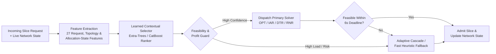

# Objective 3 — Learned Solver Selection for 5Guard

Objective 3 develops a learning-based solver-selection framework that dynamically selects allocation solvers for incoming network slice requests. By replacing brute-force parallel execution with context-aware, guarded solver selection, the framework simultaneously reduces computational overhead, lowers decision latency, and improves both slice admissions and allocation profitability.

---

## System Architecture — How It Works



Instead of running all four solvers (`OPT`, `IAR`, `DTR`, `RNR`) in parallel for every request, the framework extracts 27 contextual features, predicts solver performance and feasibility, and dispatches only the most suitable solver—falling back selectively when needed.

---

## What We Built

1. **Common-state measurement.** Evaluated `OPT`, `IAR`, `DTR`, and `RNR` on identical allocation states to benchmark execution time, allocation feasibility, and incremental profit.
2. **Extra-Trees performance selector.** Trained a machine-learning selector using 27 request, topology, and allocation-state features to predict solver execution time, profitability, and completion performance.
3. **Ranker and cascade experiments.** Implemented CatBoost-based solver ranking and a learned `OPT`/`IAR` cascade to optimize solver execution order and eliminate redundant computation.
4. **Guarded contextual solver selection.** Built an adaptive selection and fallback strategy incorporating network load, isolation requirements, and active network-slice state to dynamically choose solver execution plans.
5. **Matched parallel evaluation.** Benchmarked the proposed selector against parallel 5Guard using the SCIP backend, consistent 6 s deadlines, and identical incoming request sequences.

---

## Main Results — Three Full Synthetic Sequences

The matched evaluation processed **420 network-slice requests** across three full synthetic sequences (140 requests each).

### Performance Comparison

| Metric | Parallel 5Guard | Guarded Contextual Selector | Change vs. Parallel |
| --- | --- | --- | --- |
| Mean decision latency | 3.5351 s | **1.4856 s** | **57.97% lower** |
| Mean full cycle time | 3.7460 s | **1.5697 s** | **58.10% lower** |
| Mean CPU time per decision | 6.1259 s | **1.4207 s** | **76.81% lower** |
| Mean solver calls per request | 4.000 | **1.205** | **69.88% fewer** |
| p95 decision latency *(6 s deadline cap)* | 6.0157 s | **6.0135 s** | **0.04% lower** |
| On-time admissions | 250 / 420 | **271 / 420** | **8.40% higher** |
| Mean admitted slices per sequence | 83.33 | **90.33** | **+7.00 slices (+8.40%)** |
| Mean final profit per sequence | 52,035.87 | **67,234.00** | **29.21% higher** |
| Recorded solver errors | 0 | **0** | **Zero errors** |

### Performance Highlights

The guarded contextual selector outperforms parallel 5Guard across **both computational efficiency and allocation quality**:

* **57.97% lower** mean decision latency (`1.4856 s` vs. `3.5351 s`).
* **58.10% lower** full cycle execution time (`1.5697 s` vs. `3.7460 s`).
* **76.81% lower** CPU time per decision (`1.4207 s` vs. `6.1259 s`).
* **69.88% fewer** solver invocations (`1.205` vs. `4.000` calls/request).
* **29.21% higher** mean final profit (`67,234.00` vs. `52,035.87`).
* **8.40% more** on-time slice admissions (`90.33` vs. `83.33` slices/sequence).
* **Zero** recorded solver errors across all 420 requests.

---

## Earlier Exploratory Comparisons

*Evaluated during iterative development prior to the final three-sequence matched SCIP benchmark.*

| Experiment | Measured Improvement |
| --- | --- |
| Extra-Trees vs. sequential FGR-style replay | 86.49% lower execution time |
| Extra-Trees vs. retrained RF + OPT | 27.41% higher mean profit |
| CatBoost vs. Extra-Trees | 24.80% lower mean latency |
| Learned OPT/IAR cascade vs. parallel OPT + IAR | 44.2% lower CPU time |
| Earlier guarded selector vs. parallel 5Guard (Sequence 7) | 8.28% higher profit |

---

## Conclusion

Objective 3 demonstrates that learned, feasibility-aware solver selection outperforms parallel 5Guard on every evaluated dimension—cutting mean decision latency by **57.97%**, CPU utilization by **76.81%**, and solver calls by **69.88%**, while simultaneously increasing mean admitted slices to **90.33** and boosting mean final profit by **29.21%** (`67,234.00`) with zero solver errors.

```

