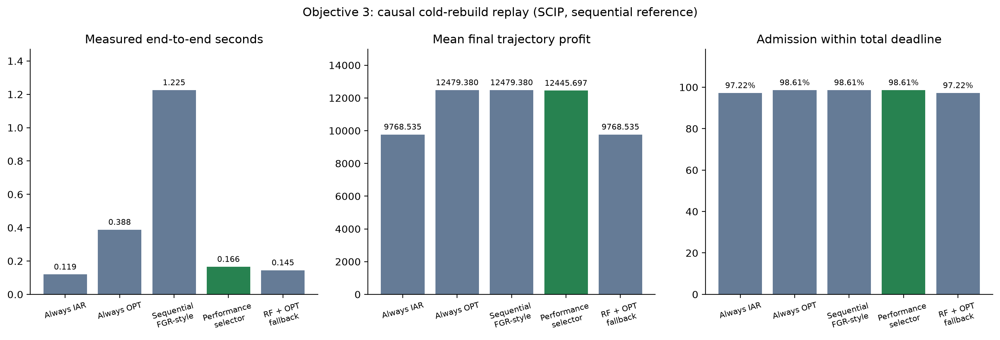

# Objective 3: Performance-Based Selection and Causal Replay

This experiment adds an actual solver replay to the earlier offline selector.
Each policy receives the same requests and maintains its own evolving allocation state.
Training labels come from four candidates evaluated on copies of one common state.

## Evaluation design

- Topology: **synthetic**; solver: SCIP; one solver thread.
- Requests per sequence: **12**.
- Training seed groups: `[100, 101, 102, 103, 104, 105]`.
- Validation seed groups: `[200, 201]`; calibration and threshold tuning use separate validation groups when available.
- Test seed groups: `[400, 401, 402, 403, 404, 405]`; identical incoming sequences for every policy.
- SCIP optimization limit: 2.0 seconds per call; full elapsed deadline is checked separately.
- The RF + OPT comparator is retrained on the new training data and richer features. It represents the old decision rule, not the exact saved legacy model.
- FGR-style reference: sequentially evaluate four cold-rebuilt candidates and apply the upstream OPT-priority rule.
- Wall-clock timing includes features, prediction, copying, model reconstruction, allocation, and retries. CPU timing covers the current process.

A development pilot used test seeds 300--303 and exposed a mismatch between incremental-profit gating and the total-profit oracle. After correcting that rule, gates were selected again using validation data and the reported final replay used fresh seeds 400--405. Pilot artifacts are retained locally outside the final report directory.

## Implemented changes

1. Actual request/graph-size features and placement-based load proxies, replacing fixed service profiles alone.
2. Extra-Trees prediction of each candidate's log-runtime, incremental profit, and completion-success score.
3. Sigmoid completion-score calibration where calibration data contain both outcome classes; validation-only selection of quality and feasibility gates.
4. Ranking candidates by predicted time subject to predicted quality and feasibility; at most one retry if predicted remaining deadline permits.
5. Consistent same-state candidate collection, followed by causal online evaluation on disjoint test seeds.
6. Isolated temporary solver models, explicit error records, and a check that profit cannot exceed admitted revenue.

The cold-rebuild adapter marks all requests as requiring constraints, initializes missing shared auxiliary variables, and preserves the local OPT correction that clamps negative numerical violation costs. It is applied in memory; upstream files are not overwritten. The SCIP compatibility layer is tracked in `src/secguard/solver_compat.py`.

## Measured online results

| Policy | Mean elapsed time (s) | p95 elapsed time (s) | Mean final profit | Admission within deadline | Mean solver calls | Solver errors |
|---|---:|---:|---:|---:|---:|---:|
| performance_selector | 0.1655 | 0.2952 | 12445.70 | 98.61% | 1.028 | 0 |
| rf_opt_fallback | 0.1449 | 0.2693 | 9768.54 | 97.22% | 1.000 | 0 |
| fgr_sequential | 1.2252 | 2.7413 | 12479.38 | 98.61% | 4.000 | 0 |
| always_opt | 0.3880 | 0.8769 | 12479.38 | 98.61% | 1.000 | 0 |
| always_iar | 0.1195 | 0.2490 | 9768.54 | 97.22% | 1.000 | 0 |

Final profit is measured at the end of each policy's own trajectory and then averaged across test seeds. It is not the older mean per-decision profit-quality score.

## Comparison with the sequential FGR-style reference

- Mean elapsed-time reduction: **86.49%**.
- Process CPU-time reduction: **86.37%**.
- Measured solver-call reduction, including retries: **74.31%**.
- Ratio of mean final profits: **99.73%**.
- Admission-within-deadline change: **+0.00 percentage points**.

## Comparison with the RF + OPT rule

- Mean elapsed-time reduction: **-14.27%** (negative means slower).
- Ratio of mean final profits: **127.41%**.
- Admission-within-deadline change: **+1.39 percentage points**.



Figure: online elapsed time, final trajectory profit, and admission within the total deadline. Every policy includes all arrivals, including failures.

## Held-out common-state selection audit

This diagnostic runs all candidates on common test states after the model is frozen. These additional diagnostic solves are excluded from online policy latency and call counts. Ranking is evaluated before retry.

| Rule | Oracle-label accuracy | Mean bounded quality, all rows | Feasible, all rows | Eligible oracle rows |
|---|---:|---:|---:|---:|
| performance_selector | 77.46% | 77.21% | 77.78% | 71 |
| rf_opt_fallback | 76.06% | 76.74% | 77.78% | 71 |
| fgr_style | 2.82% | 98.61% | 98.61% | 71 |

Rows where no candidate is feasible have no oracle algorithm label; they remain in quality and success denominators with zero score. These audit rows differ from the legacy 329-row test set, so new accuracy must not be described as a direct improvement from 66.57%.

The common-state audit follows separate behavior trajectories and evaluates only the first ranked solver. Its feasibility/quality figures therefore differ from the actual online trajectories with bounded retry. They expose limitations on states beyond the selector's own trajectory.

## Uncertainty and limits

- Current selector minus fgr_sequential, latency: mean paired delta -1.0597 seconds; seed-level bootstrap 95% interval [-1.1092, -1.0105].
- Current selector minus fgr_sequential, profit: mean paired delta -33.6830 profit units; seed-level bootstrap 95% interval [-99.7157, -0.0000].
- Current selector minus rf_opt_fallback, latency: mean paired delta 0.0207 seconds; seed-level bootstrap 95% interval [0.0030, 0.0411].
- Current selector minus rf_opt_fallback, profit: mean paired delta 2677.1613 profit units; seed-level bootstrap 95% interval [0.0000, 8031.4840].

The intervals resample whole test seeds. With only a few short sequences, they are descriptive and do not establish broad generalization.

- Short synthetic request sequences do not establish production or BRAIN generalization.
- Cold rebuilding removes cache contamination but differs from the original incremental 5Guard solver; the adapter rebuilds all request constraints and missing auxiliary variables.
- CPU timing is process CPU time; external child-process costs are not relevant to this sequential in-process backend.
- Fallback budget is checked before retry; upstream model construction is not preemptible, and overruns count as failures.
- Demand occupancy features approximate load and exclude isolation/orchestration overhead; exact residual transport bandwidth is unavailable from X/Y.
- Sigmoid calibration is fitted only when both outcome classes exist in separate calibration seed groups; small calibration samples do not guarantee reliability.
- This comparison does not establish superiority over the upstream parallel ensemble. Cold rebuilding corrects missing cached constraints but adds overhead to every policy, especially the four-candidate reference.
- Legacy numbers (66.57% accuracy, 23.44% estimated solver-work reduction, 0.7523 s stored FGR time) use a different dataset, timing definition, and solver path. They are not directly comparable to this benchmark.
- Broader BRAIN/topology, long-horizon, load, and repeated-run evaluation remains necessary.

## Reproduction

```powershell
python -m secguard.online_selector --steps 12 --topology synthetic --solver-seconds 2.0 --train-seeds 100 101 102 103 104 105 --validation-seeds 200 201 --test-seeds 400 401 402 403 404 405 --output-dir artifacts/objective3_online
python -m secguard.online_selector --steps 12 --topology synthetic --solver-seconds 2.0 --train-seeds 100 101 102 103 104 105 --validation-seeds 200 201 --test-seeds 400 401 402 403 404 405 --output-dir artifacts/objective3_online --audit-only
python scripts/report_objective3_online.py --results artifacts/objective3_online/results.json
```

For custom seeds/topology/solver limits, pass the values in `results.json` explicitly; audit arguments must match the original experiment.

Evidence: `results.json`, `training.json`, `validation.json`, `test_common_state.json`, and `paired_intervals.json` in this directory.
