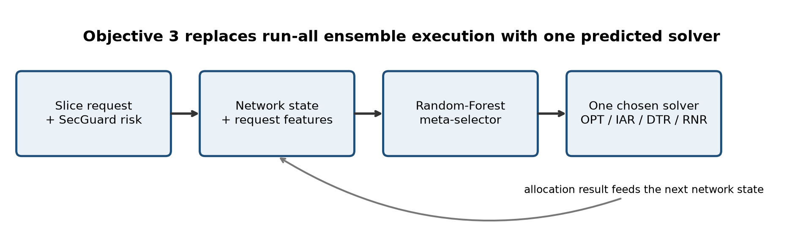
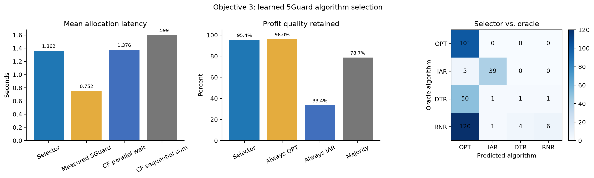

# Objective 3: Intelligent Algorithm Selection

## Objective

Objective 3 replaces 5Guard's run-all ensemble with a lightweight meta-selector.
For each admitted slice, the selector predicts one algorithm from `OPT`, `IAR`,
`DTR`, and `RNR` using request complexity and the previous network state. The
goal is to reduce allocation latency without materially sacrificing profit or
deadline feasibility.

## Implementation

The current research prototype uses a 400-tree Random Forest trained on measured
per-step outcomes from the existing 5Guard reproduction. Its 22 input features
contain only information available before the current allocation:

- service type, isolation, CPU, radio, bandwidth, revenue, and deadline;
- time within the simulation and the recent service-arrival mix; and
- previous profit, migration, latency, violation, overhead, resource-efficiency,
  and rejection state.

The training label is the fastest deadline-feasible algorithm whose observed
profit is within 5% of the best feasible candidate. Predictions below 60%
confidence fall back to `OPT`. This safety gate favors solution quality during
distribution shift.

Training uses complete simulation groups: iterations 0--6 train the selector,
while iterations 7--9 remain held out. Rows from the same simulation are never
randomly split between training and evaluation.

## Architecture



## Reproduction

```powershell
python -m secguard.algorithm_selector
```

This command reads the existing synthetic 5Guard traces from
`external/5guard/saved_data/synthetic/`, trains the selector, evaluates all
baselines, and regenerates the model, JSON evidence, figure, and diagram.

## Held-out results

The evaluation contains 329 deadline-feasible decision points from held-out
simulation iterations 7--9.

| Policy | Mean latency (s) | Mean profit retained | Feasibility/deadline rate |
|---|---:|---:|---:|
| Confidence-gated selector | **1.3615** | 95.35% | 95.44% |
| Always OPT | 1.3760 | **96.05%** | **96.05%** |
| Always IAR | **0.0087** | 33.44% | 51.98% |
| Always RNR / training majority | 0.1104 | 78.67% | 79.64% |
| Quality-constrained oracle | 0.8209 | 99.82% | 100.00% |

Measured FGR/5Guard latency was 0.7523 seconds per decision. For context, the
independent candidate trajectories give a counterfactual parallel wait of
1.3760 seconds and a counterfactual sequential sum of 1.5994 seconds. These are
not causal measurements of the FGR trajectory. The selector therefore:

- was **80.98% slower** than measured FGR on the held-out trace;
- was 1.05% faster than always selecting OPT on the independent trajectories;
- retained **95.35%** of the best observed profit on average;
- placed **94.53%** of selections within the 5% profit-loss budget;
- achieved **95.44%** deadline-feasible selections; and
- required sub-millisecond mean inference time per request in this run.

The 60% confidence gate activated on 75.68% of held-out decisions. It protects
quality but makes the selector behave mostly like OPT. The result does not meet
the original aspirational target of a 90% latency reduction and does not yet
justify replacing measured FGR execution.



## Evidence and verification

- Implementation: `src/secguard/algorithm_selector.py`
- Unit tests: `tests/test_algorithm_selector.py`
- Metrics: `artifacts/objective3_algorithm_selector.json`
- Trained model: `artifacts/objective3_selector.joblib`
- Result figure: `artifacts/objective3_algorithm_selector.png`
- Architecture diagram: `artifacts/objective3_architecture.png`
- Complete project test suite: **37 tests passed**

## Limitations and next work

- Counterfactual candidate outcomes come from independent algorithm trajectories,
  not a single causal replay trajectory.
- Training and testing use one topology and one seeded traffic generator.
- The confidence fallback protects quality but substantially limits latency gain.
- BRAIN-topology evaluation, direct online integration, probability calibration,
  and broader workload validation remain necessary before claiming generalization.
