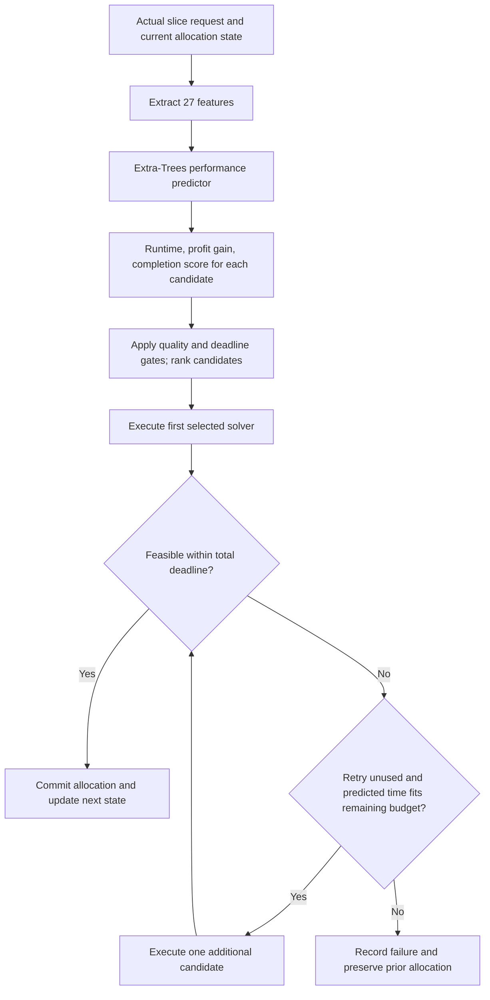
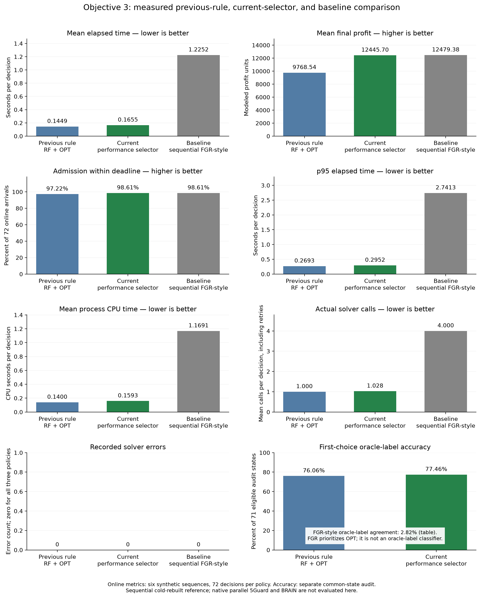
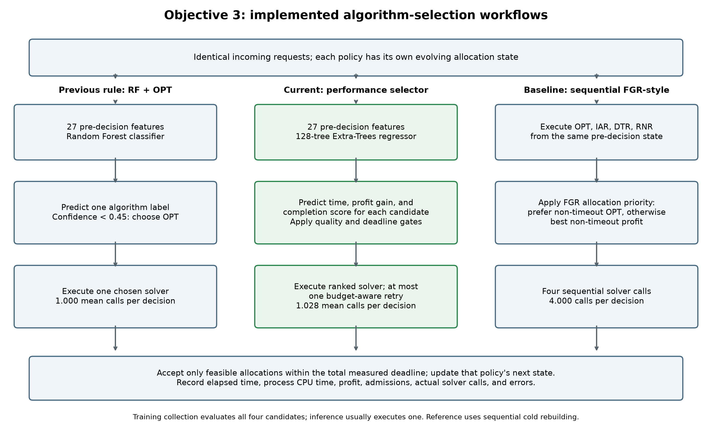

# Objective 3: Implemented Algorithm Selection and Measured Results

## 1. Methodology and implementation

The implementation uses common-state training data, actual resource and
request-complexity features, candidate-specific runtime/profit/success
prediction, validation-only configuration selection, and a budget-aware retry.
Each policy's accepted allocations update its own next state.

| Component | Implementation | Purpose |
|---|---|---|
| Prediction task | Predict runtime, incremental profit, and completion-success score for each algorithm | Compare expected outcomes explicitly |
| Features | 27 actual request, topology-size, and allocation-state features | Represent request difficulty and current resource pressure |
| Candidate training data | Four candidates evaluated on copies of the same pre-decision state | Make candidate comparisons consistent |
| Selection rule | Fastest predicted candidate meeting configured quality, feasibility, and deadline gates | Balance computation against expected allocation quality |
| Failure handling | At most one retry when predicted runtime fits the remaining deadline budget | Recover from a failed first choice while accounting for extra work |
| State transition | Execute the selected solver and commit its accepted allocation | Measure consequences over an evolving sequence |
| Timing | Actual elapsed time and process CPU time, including selection overhead and retries | Measure the policy's execution cost |


### Difference between the previous and current approaches

| Aspect | Previous selection rule: RF + OPT | Current approach: performance selector |
|---|---|---|
| Input | 27 request, topology, and allocation-state features | The same 27 features |
| Learning method | Random Forest classification | Extra-Trees regression with 128 trees |
| Model output | One predicted algorithm label and its classification confidence | Predicted runtime, incremental profit, and completion score for each of OPT, IAR, DTR, and RNR |
| Selection decision | Use the predicted label when confidence is at least 0.45; otherwise choose OPT | Prefer the fastest candidate passing the deadline, completion-score, and predicted total-profit quality gates |
| Failure handling | One solver call | At most one additional solver call if the remaining deadline budget allows |
| Measured tradeoff | Lower elapsed time than the current selector | 27.41% higher final profit and 1.41 percentage points higher oracle-label agreement, with 14.27% more elapsed time |

Both approaches use supervised learning to choose an allocation algorithm.
The chosen solver computes the actual allocation and realized profit. The
current model estimates candidate outcomes before execution; it does not
execute all four solvers for each online decision.

The Extra-Trees model has 128 trees. Its inputs include actual CPU, radio,
and bandwidth demands; VNF, VNF-instance, and virtual-link counts; topology
size; active slices; existing placements; demand-based load and remaining
capacity proxies; fragmentation; isolation; deadline; revenue; and previous
profit and runtime. The load proxies exclude some isolation/orchestration
overhead, and exact residual transport bandwidth is not available from X/Y.

At each request, the controller:

1. Extracts the 27 features from the incoming request and its own current state.
2. Predicts runtime, incremental profit, and completion success for all four
   candidate algorithms.
3. Filters candidates using the predicted completion score and request
   deadline, and applies a profit-loss budget relative to predicted **total
   allocation profit**. The selected validation settings were 0.95 for quality
   and 0.50 for the completion-score gate.
4. Ranks qualifying algorithms by predicted runtime and executes the first.
   If none qualifies, it ranks candidates by predicted completion success and
   runtime; these predictions do not guarantee feasibility.
5. If the first solver fails, considers one additional candidate only when
   its predicted runtime, with a margin, fits the remaining time budget.
6. Commits the allocation only when it is feasible and completes within the
   total measured request deadline. Otherwise it preserves the prior state.

The runtime adapter reconstructs all required constraints in isolated temporary
models rather than mixing cached models from different solver histories.
Output checks reject invalid results such as profit exceeding total admitted
revenue. Deadline checks count overruns as failures; upstream model
construction is not preemptible, so the runner is not a hard real-time system.



The controller aims to execute one solver per decision. The measured average
is 1.028 calls because bounded retries are included; the run-all reference
executes four candidates per decision.

## 2. Evaluation design and measured impact

The experiment uses training decision points from seeds 100--105, 12
calibration points from seed 200, and 12 configuration-selection points from
seed 201. The final online evaluation uses six fresh seeds, 400--405, with 12
arrivals each. Models and gates are fixed before those final tests. Completion
scores receive sigmoid calibration only where calibration data contain both
success and failure classes; the small sample does not guarantee reliable
probabilities.

In this run, sigmoid calibration was fitted for IAR only. OPT, DTR, and RNR
had only one outcome class in the calibration group, so their calibration was
unavailable. The backend was SCIP with one solver thread and a two-second
optimization limit per call; total elapsed deadline checks also include model
construction, inference, and retries.

See the [measured replay report](artifacts/objective3_online/README.md) for the
metrics and [three-approach comparison figure](artifacts/objective3_online/approach_comparison.png).
The benchmark times a sequential cold-rebuilt FGR-style reference. All policy
timing includes feature extraction, inference, model rebuilding, allocation,
and any retry.

| Metric | Previous selection rule: RF + OPT | Current approach: performance selector | Baseline: sequential FGR-style | Current vs previous rule | Current vs FGR-style baseline |
|---|---:|---:|---:|---|---|
| Mean measured elapsed time per decision | 0.1449 s | **0.1655 s** | 1.2252 s | 14.27% higher (slower) | **86.49% lower (faster)** |
| p95 measured elapsed time | 0.2693 s | **0.2952 s** | 2.7413 s | 9.62% higher (slower) | **89.23% lower (faster)** |
| Mean process CPU time per decision | 0.1400 s | **0.1593 s** | 1.1691 s | 13.80% higher | **86.37% lower** |
| Mean solver calls, including retries | 1.000 | **1.028** | 4.000 | 2.78% more calls | **74.31% fewer calls** |
| Mean final trajectory profit | 9768.54 | **12445.70** | 12479.38 | **27.41% higher** | 0.27% lower (99.73% retained) |
| Admission within total deadline | 97.22% | **98.61%** | 98.61% | **+1.39 percentage points** | Unchanged |
| Solver errors | 0 | **0** | 0 | Unchanged: zero errors | Unchanged: zero errors |
| Oracle-label agreement, separate common-state audit | 76.06% (54/71) | **77.46% (55/71)** | 2.82% (2/71) | **+1.41 percentage points (one additional correct decision)** | +74.65 percentage points (different selection objective; see audit explanation below) |

Changes are calculated from the unrounded saved results. Relative change is
100 × (current − reference) / reference; changes in admission rate and
oracle-label agreement are expressed in percentage points. Higher profit and
admission rates are favorable; lower elapsed time, CPU time, and solver calls
are favorable. The accuracy gain over the previous rule is one additional
correct decision out of 71.

The previous selection rule is retrained on the same training data and 27
features used in this benchmark; it is not the unchanged saved classifier from
a different experiment. All online columns use the same six input sequences.
The baseline executes four cold-rebuilt candidates sequentially and applies
the FGR OPT-priority rule; it is not native parallel 5Guard.

Oracle-label agreement is measured separately from online trajectory profit
and timing. Its oracle chooses the fastest feasible algorithm within the
configured profit-loss tolerance. FGR prioritizes OPT rather than optimizing
agreement with that label, so its low label agreement does not imply low
allocation profit. One audit row has no feasible candidate, leaving 71
oracle-eligible rows; all arrivals remain in the online metrics.

| Current approach compared with | Measured impact |
|---|---|
| Previous RF-plus-OPT selection rule | **27.41% higher final profit**, **+1.39 percentage points** admission within deadline, and **+1.41 percentage points** oracle-label agreement; elapsed time is **14.27% higher** |
| Sequential FGR-style baseline | **86.49% lower elapsed time**, **86.37% lower process CPU time**, **74.31% fewer solver calls**, and **99.73% of final profit retained**, with the same admission-within-deadline rate |

The test contains six unseen seeds (400--405), with 12 arrivals each. Against
always selecting OPT, the new selector reduces mean elapsed time by **57.33%**
while retaining the same 99.73% final-profit ratio. Against the retrained
RF-plus-OPT rule on these new features, it increases mean final profit by
**27.41%** and admission-within-deadline by **1.39 percentage points**, but takes
**14.27% more elapsed time**. Those comparisons use actual policy trajectories.



*Figure 2. Direct comparison of the previous RF-plus-OPT rule, current
performance selector, and sequential FGR-style reference. The panels show mean
and p95 elapsed time, mean final profit, admission within deadline, process CPU
time, actual solver calls, recorded solver errors, and first-choice oracle-label
accuracy. Online metrics follow each policy's own trajectory;
accuracy uses a separate audit with 71 oracle-eligible states. FGR's
2.82% oracle-label agreement is recorded in the table rather than plotted as
classifier accuracy. Elapsed time includes selection, rebuilding, allocation,
and retries. The reference is sequential, not a parallel production ensemble.*

The figure shows the measured trade-off: versus RF plus OPT, the current
selector gains 27.41% final profit and 1.41 percentage points of oracle-label
accuracy, but takes 14.27% more elapsed time. Versus the sequential FGR-style
reference, it reduces elapsed time by 86.49% and retains 99.73% of final profit.



*Figure 3. Implemented workflows for the previous RF-plus-OPT rule, the current
performance selector, and the sequential FGR-style reference. Each policy
receives the same requests but maintains its own allocation state. The RF
comparator is retrained on the same 27 features. The current selector predicts
three outcomes per candidate and permits one budget-aware retry.*

The elapsed-time saving versus the sequential reference comes primarily from
executing approximately one candidate instead of four, while the performance
estimates guide which candidate to run. The state features and bounded retry
help preserve trajectory profit. These components were changed together;
separate ablations are still required to attribute a numerical gain to each.

The baselines answer different questions:

| Comparison | What it establishes in this benchmark |
|---|---|
| Sequential cold-rebuilt FGR-style reference | 86.49% less elapsed time and 86.37% less process CPU time while retaining 99.73% of mean final profit |
| Always OPT | 57.33% less elapsed time with 99.73% of mean final profit retained |
| Retrained RF-plus-OPT decision rule | 27.41% higher mean final profit and +1.39 percentage points admission within deadline, at a cost of 14.27% more elapsed time |

The RF-plus-OPT comparator is a classification baseline trained on the same
request features and training data. It chooses the predicted algorithm when
confidence is at least 0.45 and chooses OPT otherwise. This comparison tests
the selection rules under the same replay conditions.

## 3. Accuracy, profit retention, and scope

A separate held-out common-state audit gives **77.46% oracle-label accuracy**
(55/71 eligible decisions) for the performance selector, versus **76.06%**
(54/71) for the retrained RF-plus-OPT baseline. This is one additional exact
match on the same audit and does not establish a consistent accuracy gain. In this separate audit the first ranked solver is feasible
on 77.78% of all audit rows; the online result above follows each policy's own
state trajectory and includes bounded retries.

Accuracy measures agreement with the fastest qualifying oracle algorithm.
Final-profit retention measures the ratio of average profits at the end of
complete policy trajectories. Admission within deadline counts accepted,
feasible requests among all online arrivals. These percentages have different
denominators and should not be treated as interchangeable measures of success.

The evidence supports a faster selector than the controlled sequential
reference and always-OPT on short synthetic sequences, with a small profit
trade-off. It does not yet establish superiority over native parallel 5Guard,
longer-horizon workloads, or the BRAIN topology.


## Implementation and retained evidence

- [Performance selector and causal replay](src/secguard/online_selector.py)
- [Tracked SCIP adapter](src/secguard/solver_compat.py)
- [Measured replay report](artifacts/objective3_online/README.md)
- [Full results and decision records](artifacts/objective3_online/results.json)
- [Training records](artifacts/objective3_online/training.json)
- [Validation records](artifacts/objective3_online/validation.json)
- [Held-out common-state audit](artifacts/objective3_online/test_common_state.json)
- [Paired seed-level intervals](artifacts/objective3_online/paired_intervals.json)
- [Selection and replay tests](tests/test_online_selector.py)

## Reproduction

```powershell
# Existing measured experiment configuration; these commands rerun experiments.
python -m secguard.online_selector --steps 12 --test-seeds 400 401 402 403 404 405
python -m secguard.online_selector --steps 12 --test-seeds 400 401 402 403 404 405 --audit-only

# Reporting and plotting only; no training or allocation solves.
python scripts/report_objective3_online.py
python scripts/plot_objective3_comparison.py
```

The earlier independent-trace experiment is retained in its original numerical
artifacts for provenance. It is not used as the source for the measurements,
architecture, or comparisons in this report.
